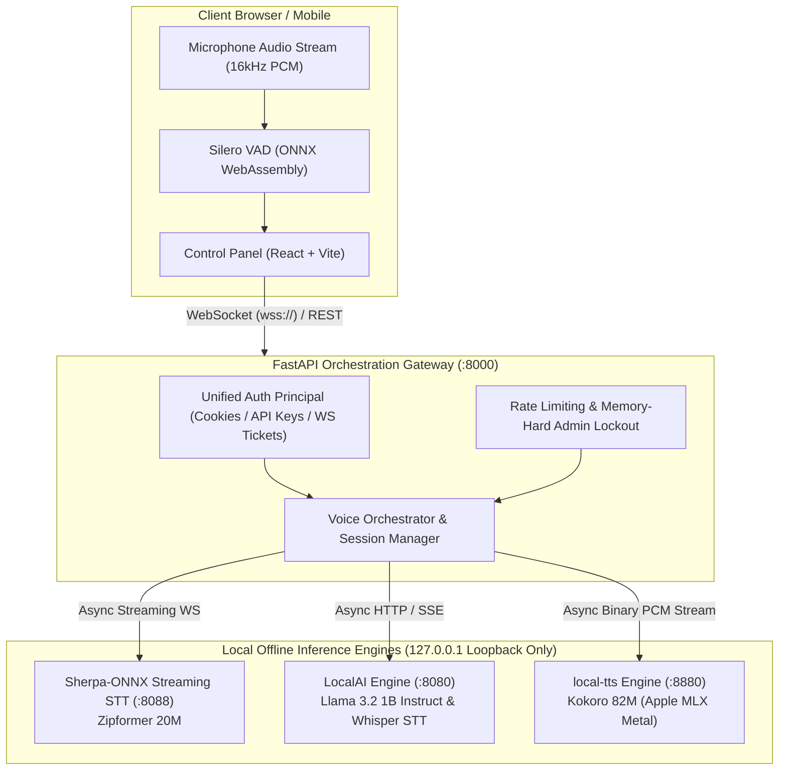

# Local Voice Agent Platform

A production-grade, privacy-first, fully local Voice AI platform featuring a high-concurrency **FastAPI gateway**, real-time streaming speech-to-text (**Sherpa-ONNX Zipformer**), local large language models & batch STT (**LocalAI**), low-latency speech synthesis (**Kokoro MLX**), and a reactive **React Control Panel** with client-side Voice Activity Detection (**Silero VAD** via WebAssembly).

---

## 1. System Architecture



---

## 2. Hardware and Operating System Requirements

| Environment | Operating System | Acceleration | Supported Capabilities |
|---|---|---|---|
| **Local Development** | macOS 13+ (Ventura, Sonoma, Sequoia) | Apple Silicon (Metal GPU & Neural Engine) | Full duplex voice pipeline, streaming STT, LocalAI LLM, Kokoro MLX TTS |
| **Production Server** | Linux x86_64 (Ubuntu 22.04 / 24.04 LTS) | NVIDIA GPU (CUDA 12.x) | Streaming STT, LocalAI LLM & Whisper STT, Clean HTTP 503 TTS fallback |
| **Edge / Minimal** | Linux x86_64 / Debian | CPU Only | Basic STT and LLM inference, Clean HTTP 503 TTS fallback |

> [!NOTE]
> Kokoro speech synthesis on Apple MLX runs exclusively on Apple Silicon macOS. On Linux environments (such as Hetzner or RunPod), the gateway cleanly reports Text-to-Speech as unavailable (HTTP 503) without crashing.

---

## 3. Quick Start

### 3.1 Automated Setup
Run the automated environment setup script. This script configures the Python virtual environment, installs pinned dependencies, builds the frontend, downloads required models, generates secure cryptographic secrets, and initializes the database:

```bash
./scripts/setup.sh
```

### 3.2 Starting All Services
Launch the complete stack (LocalAI, local-tts, Sherpa-ONNX STT, FastAPI Gateway, and Vite Frontend):

```bash
./scripts/start-all.sh
```

All engines are strictly bound to loopback `127.0.0.1`. The gateway listens on `http://127.0.0.1:8000` (or configured `GATEWAY_HOST`) and the frontend on `http://127.0.0.1:5173`.

### 3.3 Initial Super Admin Login
1. Open `http://127.0.0.1:5173` in your browser.
2. Log in using username `admin` and the initial password generated by `./scripts/setup.sh` (or configured via `ADMIN_INITIAL_PASSWORD`).
3. You will be automatically redirected to the forced password change screen (`/change-password`). Set a new password with at least 12 characters.
4. Once completed, you will have access to the full Super Admin Control Panel.

### 3.4 Stopping All Services
```bash
./scripts/stop-all.sh
```

---

## 4. Configuration Reference

All settings can be configured via environment variables or a local `.env` file (copied from [`.env.example`](.env.example)):

| Variable | Default | Description |
|---|---|---|
| `ENVIRONMENT` | `development` | Deployment environment: `development`, `staging`, or `production`. In `staging`/`production`, weak or default passwords are strictly rejected at startup. |
| `GATEWAY_HOST` | `127.0.0.1` | Network interface for FastAPI Gateway (`0.0.0.0` only in container test runs). |
| `GATEWAY_PORT` | `8000` | Gateway HTTP listening port. |
| `TRUSTED_PROXY_IPS` | `127.0.0.1` | Comma-separated list of trusted upstream reverse proxy IPs (e.g. Caddy/Nginx) for `X-Forwarded-For` parsing. |
| `COOKIE_SECURE` | `false` | Enforces `Secure` flag on admin session cookies. Must be `true` behind TLS proxies. |
| `ADMIN_INITIAL_PASSWORD` | *(Generated)* | Initial super admin password seeded on fresh database creation (minimum 12 characters). |
| `ADMIN_API_KEY` | *(Generated)* | Full-privilege admin API key for automation and health probes. |
| `API_KEY_HASH_SECRET` | *(Generated)* | Cryptographic pepper used for HMAC-SHA256 API key hashing. |
| `DATABASE_PATH` | `data/voice_platform.db` | Path to persistent SQLite database. |
| `LOCALAI_BASE_URL` | `http://127.0.0.1:8080` | URL of internal LocalAI instance (strictly `127.0.0.1`). |
| `LOCAL_TTS_HTTP_BASE_URL` | `http://127.0.0.1:8880` | URL of internal local-tts instance (strictly `127.0.0.1`). |
| `STREAMING_STT_WS_URL` | `ws://127.0.0.1:8088/ws` | WebSocket endpoint of internal Sherpa-ONNX STT server. |

---

## 5. Security Architecture

- **Engine Isolation**: Backend inference engines (`LocalAI`, `local-tts`, `Sherpa-ONNX`) **never** listen on `0.0.0.0`. They are strictly bound to loopback `127.0.0.1` and are reachable only via the authenticated FastAPI gateway.
- **Unified Authentication Principal**: All panel routes and endpoints accept authenticated admin session cookies (`admin_session`) or scoped bearer API keys.
- **WebSocket Ticket Protocol**: WebSocket handshakes accept temporary 60-second tickets (`/v1/auth/ticket`) or direct `admin_session` cookies, preventing long-lived credential leakage in connection URLs.
- **Brute Force Protection**: Super admin authentication features Argon2id password hashing, constant-time dummy verifications, 5-attempt account lockout, and per-IP throttling over a 15-minute window.
- **Production Safety Gate**: Startup fails immediately if `ENVIRONMENT` is set to `staging` or `production` with default passwords or passwords shorter than 12 characters.

---

## 6. Testing & Quality Verification

Run the comprehensive automated test suite and security probes:

```bash
# Run 225+ automated pytest unit and integration tests
.venv/bin/pytest tests/ -q

# Run end-to-end authentication matrix probe across 31 endpoints
.venv/bin/python scripts/auth_matrix_probe.py

# Lint and format checks
ruff check . && ruff format --check .

# Frontend production build
cd frontend && npm run build
```

---

## 7. Deployment Guides

Refer to the documentation in [`docs/deploy/`](docs/deploy) for detailed production deployment instructions:
- [Hetzner Bare-Metal / Dedicated Server Deployment](docs/deploy/DEPLOY_HETZNER.md)
- [Caddy Reverse Proxy & Control Panel Configuration](docs/deploy/CONTROLPANEL_PROXY.md)
- [RunPod Container Validation & Testing Guide](docs/deploy/RUNPOD_TEST.md)
- [Example Caddyfile for Hetzner](docs/deploy/Caddyfile.hetzner.example)
- [Example Caddyfile for RunPod](docs/deploy/Caddyfile.runpod.example)

---

## 8. License

License pending owner decision. See [THIRD_PARTY_NOTICES.md](THIRD_PARTY_NOTICES.md) for licenses of third-party models and runtime libraries.
