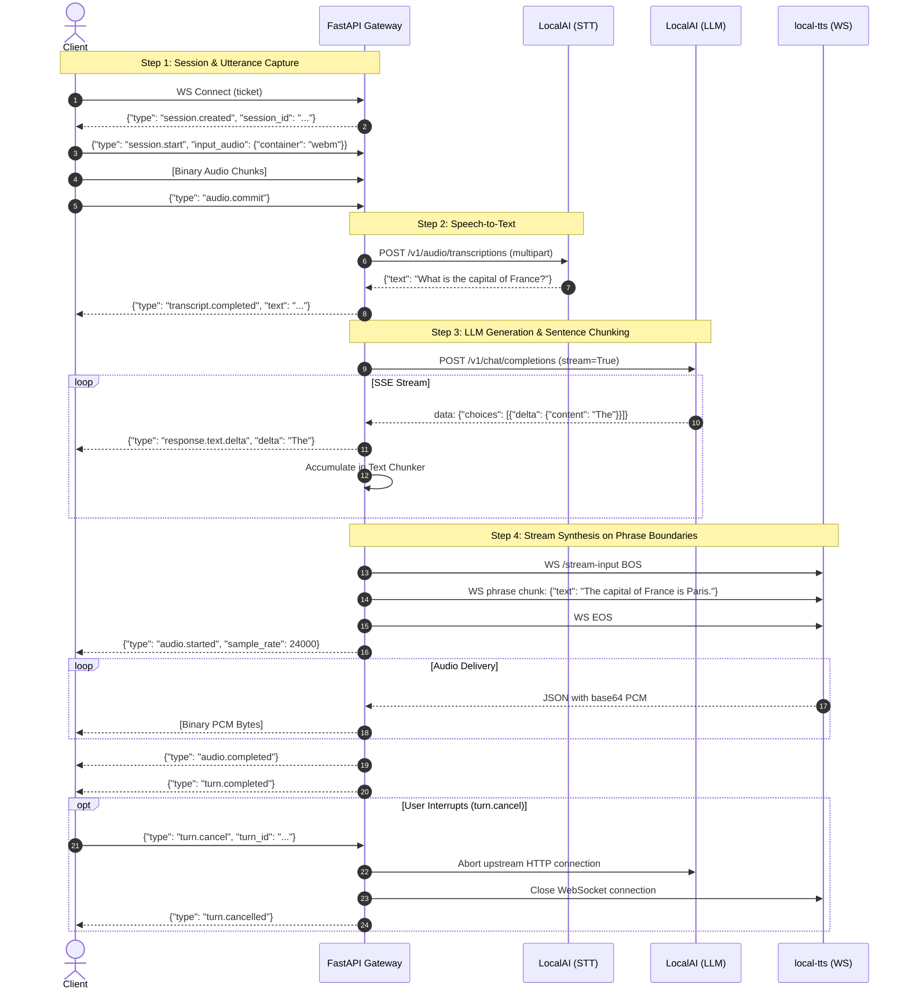

# System Architecture: Self-Hosted Voice AI Platform

## 1. Architectural Overview

The platform provides a low-latency, modular, self-hosted voice AI assistant with ElevenLabs-compatible TTS APIs and OpenAI-compatible STT/LLM endpoints. It operates with a strict separation of concerns across three services:

1. **FastAPI Gateway & Orchestration Core**:
   - Manages client HTTPS/WebSocket connections.
   - Enforces authentication (API keys and short-lived WebSocket connection tickets).
   - Maintains conversation sessions and bounded history in SQLite (`aiosqlite`).
   - Orchestrates multi-provider pipelines (STT $\to$ LLM $\to$ Sentence Chunker $\to$ TTS).
   - Coordinates client cancellation and backpressure.
   - **Does not execute model inference directly.**

2. **LocalAI Service (`mudler/LocalAI`)**:
   - Dedicated runtime for **Speech-to-Text (STT)** via `POST /v1/audio/transcriptions`.
   - Dedicated runtime for **Large Language Model (LLM)** inference via `POST /v1/chat/completions`.
   - Discovers installed models via `GET /v1/models`.

3. **local-tts Service (`saghul/local-tts`)**:
   - Dedicated runtime for **Text-to-Speech (TTS)** synthesis.
   - Supports engines: `kokoro`, `pocket`, `kitten`, `qwen`.
   - Discovers voices via `GET /v1/voices` and engines via `GET /v1/models`.
   - Exposes HTTP streaming (`POST /v1/text-to-speech/{voice_id}/stream`) and full-duplex WebSocket (`WS /v1/text-to-speech/{voice_id}/stream-input`).
   - Produces raw signed 16-bit, 24,000 Hz, mono PCM audio (`s16le`).

```
                              [ External Clients ]
                       Browser Web UI / API Consumers
                                      │
                         HTTPS / WSS (Port 8000)
                                      ▼
             ┌──────────────────────────────────────────────────┐
             │            FastAPI Public Gateway Core           │
             │  ┌────────────────────┐  ┌─────────────────────┐ │
             │  │ Auth & Ticket Svc  │  │  Session Repository │ │
             │  │ (HMAC-SHA256 Keys) │  │  (SQLite/aiosqlite) │ │
             │  └────────────────────┘  └─────────────────────┘ │
             │  ┌─────────────────────────────────────────────┐ │
             │  │              Voice Orchestrator             │ │
             │  │  - Single-turn STT/LLM/TTS Pipeline         │ │
             │  │  - Real-Time Streaming & Sentence Chunker   │ │
             │  │  - Cancellation & Task Lifecycle Manager    │ │
             │  └─────────────────────────────────────────────┘ │
             └───────────────────────┬──────────────────────────┘
                                     │ Private Loopback Network
                    ┌────────────────┴────────────────┐
                    ▼                                 ▼
      ┌───────────────────────────┐     ┌───────────────────────────┐
      │      LocalAI Service      │     │     local-tts Service     │
      │   (Default: Port 8080)    │     │   (Default: Port 8880)    │
      │                           │     │                           │
      │  • STT: Whisper / ASR     │     │  • TTS: Kokoro / Pocket   │
      │  • LLM: Chat Completions  │     │  • Raw PCM (24kHz, s16le) │
      └───────────────────────────┘     └───────────────────────────┘
```

---

## 2. Audio Pipeline & Data Formats

### 2.1 Inbound Audio (Client $\to$ Gateway $\to$ LocalAI)
- **Container / Codec**:
  - WebM (Opus) or WAV (PCM 16-bit).
  - The client must specify `container` and `codec` in the session initialization event.
- **Utterance Buffering**:
  - For real-time streaming, audio frames are buffered during the active speaking phase.
  - Upon `audio.commit`, the concatenated buffer is wrapped in a containerized file payload and passed to LocalAI `POST /v1/audio/transcriptions`.
  - True streaming ASR is an advanced capability; MVP guarantees atomic utterance transcription.

### 2.2 Outbound Audio (local-tts $\to$ Gateway $\to$ Client)
- **Format**: Raw PCM signed 16-bit little-endian (`s16le`), 24,000 Hz sample rate, single channel (mono).
- **Transport Modes**:
  1. *Synchronous turn (`POST /v1/voice/turn`)*: Base64-encoded PCM inside a JSON envelope with format metadata.
  2. *Streaming turn (`WS /v1/voice/stream`)*: Client receives JSON `audio.started` event declaring the audio spec, followed by raw binary PCM chunks over the WebSocket, concluding with an `audio.completed` JSON event.

---

## 3. Real-Time Streaming & Cancellation Lifecycle



---

## 4. Hardware Budget & Memory Constraints (8 GB Apple Silicon Target)

- Concurrent residency of a full-size local LLM (e.g. 7B+ parameters), Whisper model, and Kokoro TTS on an 8 GB unified memory Mac causes paging and OOM failures.
- **Required Operational Guidelines**:
  1. Default LLM configuration: quantized 4-bit small footprint models (e.g., Llama-3.2-1B/3B, Qwen2.5-1.5B/3B) or remote endpoint proxying through LocalAI.
  2. STT: Whisper `tiny` or `base` models.
  3. TTS: Kokoro or Pocket engine with fast single-thread synthesis.
  4. Max concurrent active voice turns: default capped to 1.
