# Multi-Agent Orchestrator Plan: Self-Hosted Voice AI Platform
*(Revised per [`AGENT.md`](./AGENT.md) Multi-Model Policy)*

---

## 1. Executive Summary & Policy Alignment

This orchestrator plan integrates the **Backend Plan** (FastAPI, LocalAI LLM/STT, `saghul/local-tts`) and **Frontend Plan** (Voice AI Control Panel, Web Audio 24kHz PCM, playgrounds, real-time assistant) into a unified execution framework.

Per the mandatory rules defined in [`AGENT.md`](./AGENT.md):
1. **Multi-model operation is enforced across the lifecycle.**
2. **`GEMINI-3.8-HIGH-flash`** is designated for **simple-to-moderate tasks** (scaffolding, API routes, database CRUD, UI components, provider adapters, test harnesses).
3. **`SONNET-4.6`** is reserved strictly for **complex tasks** (core system architecture, contract freezing, async WebSocket bi-directional streaming, Web Audio API 24kHz PCM ring buffers, cancellation/backpressure state machines, and end-to-end integration audits).

> [!CAUTION]
> **Token Hunger Guard for `SONNET-4.6`**: As highlighted in `AGENT.md`, Sonnet-4.6 is token-hungry. To protect token budget, Sonnet is strictly quarantined from boilerplate generation, repetitive test fixtures, and large context dumps. `GEMINI-3.8-HIGH-flash` prepares trimmed inputs and schemas before handing off to `SONNET-4.6`.

```mermaid
flowchart TD
    subgraph P0["P0: Architecture & Contract Freeze"]
        A0["Lead Architect (SONNET-4.6)<br/>Protocol & Event Contract Freeze"]
        S1["Type & Schema Scaffolder (GEMINI-3.8-HIGH-flash)<br/>Pydantic Models & TS Types"]
    end

    subgraph P1["P1: Core Infrastructure Foundations"]
        B4["Gateway & Security (GEMINI-3.8-HIGH-flash)<br/>FastAPI, DB, Auth & Tickets"]
        F1["Frontend Shell (GEMINI-3.8-HIGH-flash)<br/>Layout, Nav, Health Status"]
    end

    subgraph P2["P2: Provider Adapters & Playgrounds"]
        B1["LocalAI STT (GEMINI-3.8-HIGH-flash)"]
        B2["LocalAI LLM (GEMINI-3.8-HIGH-flash)"]
        B3["local-tts Client (GEMINI-3.8-HIGH-flash)"]
        F2["Playgrounds UI (GEMINI-3.8-HIGH-flash)"]
        F3["Model/Voice Pickers (GEMINI-3.8-HIGH-flash)"]
    end

    subgraph P3["P3: Synchronous Voice Turn Milestone"]
        B5A["Voice Turn API (GEMINI-3.8-HIGH-flash)<br/>POST /v1/voice/turn"]
        F4A["Turn Card UI (GEMINI-3.8-HIGH-flash)<br/>Audio Record / Upload View"]
    end

    subgraph P4["P4: Real-Time Assistant & WebSocket Streaming"]
        B5B["Streaming Voice Core (SONNET-4.6)<br/>WS Stream, Chunker, Backpressure & Cancel"]
        F4B["Web Audio Engine (SONNET-4.6)<br/>PCM 24kHz Player, Mic FSM & Interrupt"]
    end

    subgraph P5["P5: Hardening, QA & Documentation"]
        QA1["E2E & Stress Testing (GEMINI-3.8-HIGH-flash)"]
        D1["Developer Setup & Guides (GEMINI-3.8-HIGH-flash)"]
        A0_Signoff["Final Integration Sign-off (SONNET-4.6)"]
    end

    P0 --> P1
    P1 --> P2
    P2 --> P3
    P3 --> P4
    P4 --> P5
```



---

## 2. Model Allocation & Token Optimization Strategy

### 2.1 Model Selection Breakdown

| Task Complexity | Assigned Model | Rationale & Use Cases | Token Optimization Guardrails |
|---|---|---|---|
| **Complex Tasks** | **`SONNET-4.6`** | • Protocol & WebSocket event framing (`docs/api-contract.md`)<br/>• Real-time async streaming engine (`app/services/voice_orchestrator.py`)<br/>• Browser Web Audio API 24kHz signed 16-bit PCM playback pipeline<br/>• Interruption handling & cancellation race-condition logic<br/>• Final cross-system integration audit | **Token Hunger Mitigation**:<br/>1. Feed only targeted, extracted contracts (never entire codebases).<br/>2. Disallow boilerplate/docstring generation on this model.<br/>3. Limit output length to the critical algorithm or diff.<br/>4. Flash models perform all pre-work. |
| **Simple-to-Moderate Tasks** | **`GEMINI-3.8-HIGH-flash`** | • FastAPI setup, lifespan events, structured logging (`app/main.py`)<br/>• SQLite session models and CRUD repositories (`app/storage/`)<br/>• API key hashing and one-time WebSocket ticket issuer<br/>• LocalAI STT multipart client (`app/providers/localai_stt.py`)<br/>• LocalAI LLM chat client & SSE parser (`app/providers/localai_llm.py`)<br/>• local-tts HTTP & WebSocket client (`app/providers/localtts_client.py`)<br/>• Frontend layout, navigation, and provider health pollers<br/>• STT, LLM, and TTS playground views and voice library cards<br/>• Synchronous voice turn endpoint (`POST /v1/voice/turn`)<br/>• Unit tests, contract test suites, mock fixtures, and setup documentation | High-throughput, generous context window, rapid code generation for standard patterns and tests without consuming Sonnet tokens. |

---

## 3. Team Agent Roster & Ownership

```text
┌────────────────────────────────────────────────────────────────────────┐
│                        ORCHESTRATOR ARCHITECT                          │
│              Agent A0 (Model: SONNET-4.6) — Complex Systems             │
└──────────────────────────────────┬─────────────────────────────────────┘
                                   │
         ┌─────────────────────────┼─────────────────────────┐
         ▼                         ▼                         ▼
┌──────────────────────┐  ┌──────────────────────┐  ┌──────────────────────┐
│ BACKEND TEAM         │  │ FRONTEND TEAM        │  │ QUALITY & DEV REL    │
├──────────────────────┤  ├──────────────────────┤  ├──────────────────────┤
│ B4: Gateway & Auth   │  │ F1: Shell & Health   │  │ S1: Schemas/Types    │
│ (GEMINI-3.8-HIGH)    │  │ (GEMINI-3.8-HIGH)    │  │ (GEMINI-3.8-HIGH)    │
│ B1: LocalAI STT      │  │ F2: Playgrounds      │  │ T1: Fixture Factory  │
│ (GEMINI-3.8-HIGH)    │  │ (GEMINI-3.8-HIGH)    │  │ (GEMINI-3.8-HIGH)    │
│ B2: LocalAI LLM      │  │ F3: Model/Voice UI   │  │ QA1: Test Suites     │
│ (GEMINI-3.8-HIGH)    │  │ (GEMINI-3.8-HIGH)    │  │ (GEMINI-3.8-HIGH)    │
│ B3: local-tts        │  │ F4: Web Audio / Mic  │  │ D1: Docs & Setup     │
│ (GEMINI-3.8-HIGH)    │  │ (SONNET-4.6)         │  │ (GEMINI-3.8-HIGH)    │
│ B5: Voice Streaming  │  │                      │  │                      │
│ (SONNET-4.6)         │  │                      │  │                      │
└──────────────────────┘  └──────────────────────┘  └──────────────────────┘
```

### Agent Roles & Model Assignments

1. **Agent A0: System Architect & Lead Arbiter**
   - **Model:** `SONNET-4.6` *(Complex)*
   - **Files Owned:** `docs/api-contract.md`, `docs/architecture.md`, final merge coordination.
   - **Role:** Deep protocol design, race condition prevention, and architectural governance.
2. **Agent S1: Schema & Type Synchronizer**
   - **Model:** `GEMINI-3.8-HIGH-flash` *(Simple-Moderate)*
   - **Files Owned:** `app/schemas/`, `frontend/src/types/api.ts`.
3. **Agent B4: Gateway & Security Lead**
   - **Model:** `GEMINI-3.8-HIGH-flash` *(Simple-Moderate)*
   - **Files Owned:** `app/main.py`, `app/core/`, `app/api/health.py`, `app/api/models.py`, `app/storage/`.
4. **Agent B1: LocalAI STT Adapter Specialist**
   - **Model:** `GEMINI-3.8-HIGH-flash` *(Simple-Moderate)*
   - **Files Owned:** `app/providers/localai_stt.py`, `app/api/transcriptions.py`.
5. **Agent B2: LocalAI LLM Adapter Specialist**
   - **Model:** `GEMINI-3.8-HIGH-flash` *(Simple-Moderate)*
   - **Files Owned:** `app/providers/localai_llm.py`, `app/api/chat.py`.
6. **Agent B3: local-tts Client Specialist**
   - **Model:** `GEMINI-3.8-HIGH-flash` *(Simple-Moderate)*
   - **Files Owned:** `app/providers/localtts_client.py`, `app/api/tts.py`.
7. **Agent B5: Voice Streaming & Real-Time Engine**
   - **Model:** `SONNET-4.6` *(Complex)*
   - **Files Owned:** `app/services/voice_orchestrator.py`, `app/services/text_chunker.py`, `app/api/voice.py` (`WS /v1/voice/stream`).
   - **Role:** Async generator piping, utterance boundary detection, local-tts WebSocket handshake, sentence chunking, prompt cancellation.
8. **Agent F1: Frontend Shell & Navigation Lead**
   - **Model:** `GEMINI-3.8-HIGH-flash` *(Simple-Moderate)*
   - **Files Owned:** `frontend/src/components/layout/`, `frontend/src/hooks/useHealth.ts`.
9. **Agent F2: Playground Workspaces Specialist**
   - **Model:** `GEMINI-3.8-HIGH-flash` *(Simple-Moderate)*
   - **Files Owned:** STT Playground, LLM Chat Playground, TTS Playground.
10. **Agent F3: Voice & Model Library Specialist**
    - **Model:** `GEMINI-3.8-HIGH-flash` *(Simple-Moderate)*
    - **Files Owned:** Voice audition cards, model selector controls, settings persistence.
11. **Agent F4: Web Audio & Assistant Real-Time Lead**
    - **Model:** `SONNET-4.6` *(Complex)*
    - **Files Owned:** `frontend/src/audio/`, `frontend/src/pages/Assistant.tsx`.
    - **Role:** Web Audio API 24kHz signed 16-bit PCM streaming audio player, audio buffer queue scheduling, microphone stream capture & chunking, mic finite state machine (`idle` → `listening` → `transcribing` → `thinking` → `speaking`), instant interrupt execution.
12. **Agent QA1: Quality & Contract Test Engineer**
    - **Model:** `GEMINI-3.8-HIGH-flash` *(Simple-Moderate)*
    - **Files Owned:** `tests/unit/`, `tests/contract/`, `tests/integration/`.
13. **Agent D1: Documentation & Developer Experience**
    - **Model:** `GEMINI-3.8-HIGH-flash` *(Simple-Moderate)*
    - **Files Owned:** `README.md`, `.env.example`, setup guides.

---

## 4. Prioritized Execution Phases

### Phase 0: Contract Freeze & Repository Reconnaissance (P0 — Critical Path)
*Goal: Lock interfaces and protocols to prevent parallel divergence.*

- **Task 0.1 (`SONNET-4.6` / Agent A0)**: Audit repository context, hardware constraints (8 GB Mac), and draft `docs/api-contract.md`. Define WebSocket JSON control envelopes and binary PCM frame layout.
  - *Token Guard:* Provide only relevant endpoint excerpts, not the entire documentation.
- **Task 0.2 (`GEMINI-3.8-HIGH-flash` / Agent S1)**: Scaffold Pydantic DTOs (`app/schemas/`) and TypeScript interfaces (`frontend/src/types/api.ts`) matching `docs/api-contract.md`.
- **Task 0.3 (`GEMINI-3.8-HIGH-flash` / Agent T1)**: Generate deterministic test audio fixtures and mock responses.

> [!IMPORTANT]
> **Phase 0 Gate:** `docs/api-contract.md` frozen. All Pydantic and TypeScript types compiled without errors.

---

### Phase 1: Core Foundation & Gateway/UI Shell (P1)
*Goal: Working FastAPI backend and React/Vite layout shell.*

- **Task 1.1 (`GEMINI-3.8-HIGH-flash` / Agent B4)**: FastAPI app scaffold, lifespan client lifecycle, structured JSON logging, error middleware.
- **Task 1.2 (`GEMINI-3.8-HIGH-flash` / Agent B4)**: Auth layer (HMAC/SHA256 API key hashing, `xi-api-key` & Bearer headers, short-lived single-use ticket generator `POST /v1/auth/ticket`).
- **Task 1.3 (`GEMINI-3.8-HIGH-flash` / Agent B4)**: SQLite database engine with `aiosqlite` for session and message history.
- **Task 1.4 (`GEMINI-3.8-HIGH-flash` / Agent F1)**: Vite + React + Tailwind shell, sidebar navigation, top status bar.
- **Task 1.5 (`GEMINI-3.8-HIGH-flash` / Agent F1)**: Poller hooks for `/health/live`, `/health/ready`, and `/v1/providers`.

> [!NOTE]
> **Phase 1 Gate:** Backend boots with health checks and authenticated ticket routes. Frontend shows real-time provider connectivity indicators.

---

### Phase 2: Independent Provider Adapters & Playgrounds (P2 — Parallel Sprint)
*Goal: Implement and verify all 3 AI providers in isolation.*

- **Task 2.1 (`GEMINI-3.8-HIGH-flash` / Agent B1)**: LocalAI STT multipart client (`app/providers/localai_stt.py`) & `POST /v1/audio/transcriptions`.
- **Task 2.2 (`GEMINI-3.8-HIGH-flash` / Agent B2)**: LocalAI LLM chat client (`app/providers/localai_llm.py`), SSE streaming delta parser & `POST /v1/chat/completions`.
- **Task 2.3 (`GEMINI-3.8-HIGH-flash` / Agent B3)**: `saghul/local-tts` HTTP client and WebSocket streaming client (`app/providers/localtts_client.py`), voices/models discovery.
- **Task 2.4 (`GEMINI-3.8-HIGH-flash` / Agent F2)**: STT Playground (file dropzone, transcription view).
- **Task 2.5 (`GEMINI-3.8-HIGH-flash` / Agent F2)**: LLM Playground (streaming chat bubble, temperature/model controls).
- **Task 2.6 (`GEMINI-3.8-HIGH-flash` / Agent F2)**: TTS Playground (text input, voice selector, PCM audio audition).
- **Task 2.7 (`GEMINI-3.8-HIGH-flash` / Agent F3)**: Voice library cards with preview audio player; model selectors with localStorage persistence.

> [!TIP]
> **Phase 2 Gate:** All three adapters pass mocked and live smoke tests. All three frontend playgrounds functional.

---

### Phase 3: Synchronous E2E Voice Turn Milestone (P3)
*Goal: First complete audio-in to synthetic-voice-out loop.*

- **Task 3.1 (`GEMINI-3.8-HIGH-flash` / Agent B5A)**: Implement `POST /v1/voice/turn`:
  - Validate audio upload $\to$ LocalAI STT $\to$ Session DB history $\to$ LocalAI LLM $\to$ local-tts HTTP $\to$ persist turn $\to$ return JSON + base64 PCM.
- **Task 3.2 (`GEMINI-3.8-HIGH-flash` / Agent F4A)**: Implement Voice Turn UI on Assistant page (audio file upload / mic record turn card with audio player).

> [!IMPORTANT]
> **Phase 3 Gate:** A real audio utterance yields a correct transcript, LLM answer, and valid synthesized voice response.

---

### Phase 4: Real-Time Assistant & WebSocket Streaming (P4 — Complex Deep Reasoning)
*Goal: Interactive full-duplex conversational voice with sub-second time-to-first-audio and instant interruption.*

- **Task 4.1 (`SONNET-4.6` / Agent B5)**: Sentence/phrase text chunker (`app/services/text_chunker.py`):
  - Natural punctuation splitting, regex-aware abbreviations, max buffer threshold, safe flush on EOS.
- **Task 4.2 (`SONNET-4.6` / Agent B5)**: Real-time WebSocket orchestrator (`WS /v1/voice/stream`):
  - Authenticate one-time ticket.
  - Buffer binary audio frames until `audio.commit`.
  - Trigger STT, stream LLM deltas into chunker, stream phrase chunks to local-tts WebSocket (`stream-input`), emit raw PCM chunks to client.
  - **Cancellation engine**: on `turn.cancel`, abort active asyncio tasks, close local-tts WebSocket, flush pending queues, notify client.
- **Task 4.3 (`SONNET-4.6` / Agent F4)**: Web Audio API PCM Engine & Mic State Machine:
  - `AudioContext` 24kHz 16-bit signed mono PCM chunk player with jitter buffer to prevent pops and under-runs.
  - MediaRecorder / AudioWorklet mic capture sending binary audio frames.
  - State machine: `idle` $\to$ `listening` $\to$ `transcribing` $\to$ `thinking` $\to$ `speaking`.
  - Interrupt button triggering `turn.cancel` and instantly silencing playback buffer.
- **Task 4.4 (`SONNET-4.6` / Joint B5 & F4)**: Live WebSocket integration and backpressure tuning.

> [!IMPORTANT]
> **Phase 4 Gate:** Assistant plays voice response while LLM response is still streaming. Interrupt button instantly stops voice generation and playback.

---

### Phase 5: Hardening, QA & Documentation (P5)
*Goal: Production resilience, load bounds, and clean developer experience.*

- **Task 5.1 (`GEMINI-3.8-HIGH-flash` / Agent QA1)**: Automated test suite:
  - Mocked provider contract tests (`tests/contract/`).
  - Interruption and cancellation stress tests.
  - Latency benchmarks (time-to-transcript, time-to-first-audio).
- **Task 5.2 (`GEMINI-3.8-HIGH-flash` / Agent B4)**: Rate limiting, max payload limits, request ID tracing, sensitive data log sanitization.
- **Task 5.3 (`GEMINI-3.8-HIGH-flash` / Agent D1)**: Master `README.md`, step-by-step setup walkthrough for LocalAI and local-tts, curl/WebSocket verification commands, `.env.example`.
- **Task 5.4 (`SONNET-4.6` / Agent A0)**: Final architecture review, security audit, Definition of Done checklist verification.

---

## 5. Master Task Assignment & Model Matrix

| Task ID | Task Description | Priority | Complexity | Assigned Model | Token Guard Required? |
|---|---|---|---|---|---|
| **T0.1** | Reconnaissance & Protocol Contract Freeze | P0 | **Complex** | `SONNET-4.6` | **Yes**: Minimal excerpt context |
| **T0.2** | Pydantic & TypeScript Schemas Scaffolding | P0 | Simple | `GEMINI-3.8-HIGH-flash` | No |
| **T0.3** | Audio & Provider Fixtures Creation | P0 | Simple | `GEMINI-3.8-HIGH-flash` | No |
| **T1.1** | FastAPI Core Engine & Lifespan Hooks | P1 | Moderate | `GEMINI-3.8-HIGH-flash` | No |
| **T1.2** | API-Key Hashing & Ticket Auth Service | P1 | Moderate | `GEMINI-3.8-HIGH-flash` | No |
| **T1.3** | SQLite Session Storage with aiosqlite | P1 | Moderate | `GEMINI-3.8-HIGH-flash` | No |
| **T1.4** | Frontend App Shell & Router Layout | P1 | Moderate | `GEMINI-3.8-HIGH-flash` | No |
| **T1.5** | Provider Health & Status Pollers | P1 | Simple | `GEMINI-3.8-HIGH-flash` | No |
| **T2.1** | LocalAI STT Adapter (`/transcriptions`) | P2 | Moderate | `GEMINI-3.8-HIGH-flash` | No |
| **T2.2** | LocalAI LLM Adapter & SSE Streaming | P2 | Moderate | `GEMINI-3.8-HIGH-flash` | No |
| **T2.3** | local-tts Client (HTTP + WS stream-input) | P2 | Moderate | `GEMINI-3.8-HIGH-flash` | No |
| **T2.4** | STT Audio Upload Playground | P2 | Simple | `GEMINI-3.8-HIGH-flash` | No |
| **T2.5** | LLM Streaming Chat Playground | P2 | Simple | `GEMINI-3.8-HIGH-flash` | No |
| **T2.6** | TTS Synthesis & Audition Playground | P2 | Simple | `GEMINI-3.8-HIGH-flash` | No |
| **T2.7** | Voice Library Cards & Model Selectors | P2 | Simple | `GEMINI-3.8-HIGH-flash` | No |
| **T3.1** | Synchronous E2E Voice Turn Endpoint | P3 | Moderate | `GEMINI-3.8-HIGH-flash` | No |
| **T3.2** | Voice Turn Record/Upload UI Card | P3 | Simple | `GEMINI-3.8-HIGH-flash` | No |
| **T4.1** | Low-Latency Phrase & Sentence Chunker | P4 | **Complex** | `SONNET-4.6` | **Yes**: Algorithm only |
| **T4.2** | WebSocket Voice Stream & Cancellation | P4 | **Complex** | `SONNET-4.6` | **Yes**: Target service files only |
| **T4.3** | Web Audio PCM 24kHz Engine & Mic FSM | P4 | **Complex** | `SONNET-4.6` | **Yes**: Target audio modules only |
| **T4.4** | Full-Duplex Real-Time E2E Integration | P4 | **Complex** | `SONNET-4.6` | **Yes**: Stream validation only |
| **T5.1** | Contract, E2E & Cancellation Test Suite | P5 | Moderate | `GEMINI-3.8-HIGH-flash` | No |
| **T5.2** | Security Hardening & Concurrency Guard | P5 | Moderate | `GEMINI-3.8-HIGH-flash` | No |
| **T5.3** | Documentation & Developer Setup Walkthrough | P5 | Simple | `GEMINI-3.8-HIGH-flash` | No |
| **T5.4** | Final Architecture Audit & Sign-off | P5 | **Complex** | `SONNET-4.6` | **Yes**: Audit summary only |

---

## 6. Token Conservation Protocol for SONNET-4.6

To enforce the note in `AGENT.md` (*"this model is token hungry and use accordingly"*), all tasks invoking `SONNET-4.6` must adhere to these four operational guardrails:

1. **Pre-Flight Scaffolding by Gemini Flash**:
   Before `SONNET-4.6` is invoked for a complex file (e.g. `voice_orchestrator.py`), `GEMINI-3.8-HIGH-flash` writes the empty skeleton, imports, and Pydantic DTOs. Sonnet is asked only to implement the critical async generator, queue scheduling, and cancellation logic.
2. **Context Minimization**:
   Never pass raw full-project files or mock fixtures to Sonnet. Inject only the specific protocol specification from `docs/api-contract.md`.
3. **Zero Boilerplate Generation**:
   Sonnet must never generate repetitive boilerplate (e.g., standard getters, HTML structure, CSS styling, basic test fixtures). Those remain strictly in Gemini Flash's domain.
4. **Targeted Diffs**:
   Sonnet responses are constrained to focused, high-precision code blocks rather than reproducing entire multi-hundred-line files.


---

## 7. Status Board & Definition of Done

```text
STATUS BOARD:
[x] P0: Protocol & Contract Freeze (Lead: A0 [SONNET-4.6])
[x] P1: Gateway & UI Foundations (Leads: B4 [GEMINI-3.8-HIGH], F1 [GEMINI-3.8-HIGH])
[x] P2: Provider Adapters & Playgrounds (Leads: B1, B2, B3, F2, F3 [GEMINI-3.8-HIGH])
[x] P3: E2E Turn Milestone (Leads: B5A [GEMINI-3.8-HIGH], F4A [GEMINI-3.8-HIGH])
[x] P4: Real-Time Assistant & WebSocket Streaming (Leads: B5B [SONNET-4.6], F4B [SONNET-4.6])
[x] P5: Hardening, QA & Documentation (Leads: QA1 [GEMINI-3.8-HIGH], D1 [GEMINI-3.8-HIGH], A0 [SONNET-4.6])
```

### Definition of Done Checklist
- [x] Backend boots with typed environment configuration and health checks.
- [x] API-key authentication with hashing and single-use WebSocket connection tickets is operational.
- [x] LocalAI STT accurately transcribes real audio samples to normalized JSON.
- [x] LocalAI LLM generates streaming SSE completions with prompt cancellation.
- [x] local-tts reliably generates 24kHz signed 16-bit mono raw PCM over HTTP and WebSocket.
- [x] Voice Turn endpoint (`POST /v1/voice/turn`) completes full turn cycle.
- [x] Real-time WebSocket (`WS /v1/voice/stream`) emits response audio before LLM text completion.
- [x] Web Audio API player correctly streams raw PCM without clicks, under-runs, or pitch distortion.
- [x] User interruption (`turn.cancel`) halts LLM, tears down upstream TTS socket, and resets client playback immediately.
- [x] All playgrounds (STT, LLM, TTS, Voice Library) work against both real and mocked backends.
- [x] Full automated test suite passes with zero regressions (24/24 tests passing).
- [x] Reproducible installation and setup instructions documented in `README.md`.
