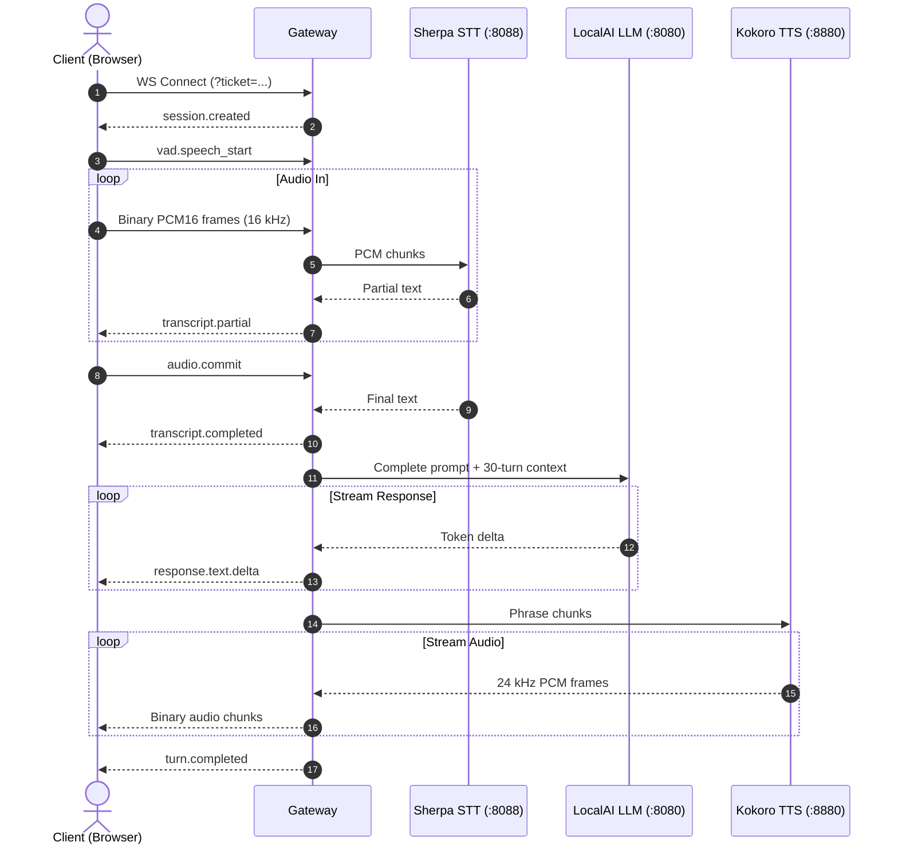

# 4. Backend and API (5 minutes)

> **TL;DR:** 42 endpoints in total. Strict role-based and scope-based access control. All caller endpoints require valid API keys with explicit scopes. Tickets expire in 60s for WebSockets. Every response contains an `x-request-id` tracing header.

---

## 4.1 Authentication & Authorization Model

- **Headers Accepted:**
  - `Authorization: Bearer <key>`
  - `xi-api-key: <key>` (ElevenLabs compatibility)
  - Query parameter `?ticket=<single_use_ticket>` (for WebSockets)
- **Hashing:** Keys are hashed using **HMAC-SHA256** (`settings.API_KEY_HASH_SECRET`) and compared using `hmac.compare_digest`. Plaintext keys are never stored.
- **Roles:**
  - `admin`: Full unrestricted control (keys, agents, profiles, model installation, memory flush, settings).
  - `caller`: Restricted to operations matching granted scopes.
- **Scopes:**
  - `llm`: Allows `POST /v1/chat/completions`
  - `stt`: Allows `POST /v1/audio/transcriptions`
  - `tts`: Allows `POST /v1/text-to-speech/*`, `GET /v1/voices`, `POST /v1/voices/*/preview`
  - `voice`: Allows `POST /v1/voice/turn`
  - `voice_stream`: Allows `WS /v1/voice/stream`
  - `stt_stream`: Allows `WS /v1/audio/transcriptions/stream`

---

## 4.2 Comprehensive Route Reference

### A. Public Routes (No Key Required)

| Method | Path | Description | Production Rule |
|---|---|---|---|
| `GET` | `/health/live` | Process liveness probe | Open |
| `GET` | `/health/ready` | Provider readiness check | Open |
| `GET` | `/health/detail` | Detailed component health | Open |
| `GET` | `/` | API root welcome banner | Open |
| `GET` | `/metrics` | Prometheus metrics scrape | **Blocked at Caddy reverse proxy** |

### B. Caller Routes (Specific Scope Required)

| Method | Path | Scope Required | Description |
|---|---|---|---|
| `POST` | `/v1/chat/completions` | `llm` | OpenAI-compatible chat completion |
| `POST` | `/v1/audio/transcriptions` | `stt` | Batch audio transcription (Whisper) |
| `POST` | `/v1/text-to-speech/{id}/stream` | `tts` | Stream synthesized audio chunks |
| `GET` | `/v1/voices` | `tts` | List installed Kokoro/TTS voices |
| `POST` | `/v1/voices/{id}/preview` | `tts` | Generate instant audio preview |
| `GET` | `/v1/tts/models` | `tts` | List available TTS synthesis models |
| `POST` | `/v1/voice/turn` | `voice` **[Confirmed]** | Multi-modal turn: audio in $\rightarrow$ audio out |

### C. General Authenticated Routes (Any Valid Key)

| Method | Path | Required Role / Scope | Description |
|---|---|---|---|
| `GET` | `/v1/models` | Valid Key | List all registered models across providers |
| `GET` | `/v1/models/installed` | Valid Key | List currently installed models |
| `GET` | `/v1/models/install/{job_id}` | Valid Key | Check progress of a model installation job |
| `GET` | `/v1/models/classifications` | Valid Key | List all task classification tags |
| `GET` | `/v1/models/classifications/stats` | Valid Key | Task distribution statistics |
| `GET` | `/v1/gallery/models` | Valid Key | Browse installable model catalog |
| `GET` | `/v1/gallery/models/{id}` | Valid Key | Get model details from catalog |
| `GET` | `/v1/system/resources` | Valid Key | Inspect CPU RAM and GPU VRAM stats |
| `POST` | `/v1/auth/ticket` | Valid Key | Mint single-use WebSocket ticket (60s TTL) |

### D. Admin-Only Routes (`role == "admin"`)

| Method | Path | Description |
|---|---|---|
| `POST` | `/v1/models/install` | Download and install model from gallery |
| `DELETE` | `/v1/models/{model_id}` | Delete model files and remove from manifest |
| `PATCH` | `/v1/models/{id}/classification` | Override task classification tag |
| `POST` | `/v1/gallery/refresh` | Refresh remote model catalog |
| `PUT` | `/v1/voices/{id}/meta` | Update voice metadata |
| `GET`, `POST` | `/v1/agents` | List or create voice agent profiles |
| `GET`, `PUT`, `DELETE` | `/v1/agents/{id}` | Retrieve, update, or remove voice agent |
| `POST` | `/v1/agents/{id}/active` | Set default active agent |
| `GET`, `POST` | `/v1/admin/keys` | List or generate API keys |
| `GET`, `PATCH`, `DELETE` | `/v1/admin/keys/{id}` | View, modify, or revoke an API key |
| `POST` | `/v1/admin/keys/{id}/rotate` | Rotate an API key with grace period |
| `GET`, `POST` | `/v1/admin/profiles` | List or create application billing profiles |
| `GET`, `PUT`, `DELETE` | `/v1/admin/profiles/{id}` | Manage application billing profile |
| `GET`, `PUT` | `/v1/admin/settings` | Read or update platform concurrency defaults |
| `GET`, `PUT` | `/v1/admin/settings/stt` | Manage global streaming STT kill switch & caps |
| `GET` | `/v1/admin/usage` | Query granular token and audio usage events |
| `GET` | `/v1/admin/usage/summary` | Aggregate hourly usage statistics |
| `GET` | `/v1/admin/usage/export` | Export usage log as CSV/JSON |

### E. Real-Time WebSockets

| Protocol | Path | Scope Required | Description |
|---|---|---|---|
| `WS` | `/v1/voice/stream` | `voice_stream` | Bi-directional voice conversation pipeline |
| `WS` | `/v1/audio/transcriptions/stream` | `stt_stream` | Live partial transcription streaming |

> **WebSocket Auth & Close Codes:** Always authenticate with a single-use ticket: `?ticket=<ticket>`. If unauthorized, server closes with RFC 6455 custom code `4401` (Unauthorized) or `4403` (Forbidden).

---

## 4.3 Voice Stream WebSocket Event Protocol

All WebSocket events are strictly modeled with Pydantic in `app/schemas/events.py`:



### Barge-in (Interruption) Handling
If the user starts speaking while TTS audio is playing:
1. Browser detects speech and sends `turn.cancel`.
2. Gateway immediately cancels active LLM generation and TTS tasks.
3. Gateway emits `turn.cancelled` and resets the turn state machine to `listening`.

---

## 4.4 Concurrency Semaphores & Quota Caps

Enforced in `app/core/limits.py` (`BackendLimiter`):
1. **Global Backend Semaphore:** Max 5 simultaneous requests per backend engine. If all 5 slots are held, requests wait in queue up to 5.0 seconds. If queue expires $\rightarrow$ returns **HTTP 503** with `Retry-After: 5`.
2. **Per-Key Concurrency Cap:** Max concurrent requests per API key (default 5, configurable per key in `api_keys.max_concurrent`). If exceeded $\rightarrow$ returns **HTTP 429** (`RATE_LIMIT_EXCEEDED`).
3. **Daily Token & Audio Quotas:** Tracked in `api_keys.max_daily_tokens` and `api_keys.max_daily_audio_seconds`. Reset daily at midnight UTC.

---

## 4.5 Standard Error Codes

Every JSON error response follows the standard structure:
```json
{
  "code": "ERROR_CODE",
  "message": "Human readable explanation",
  "request_id": "req-8f3a9b1c"
}
```

| HTTP Status | Error Code | Common Cause |
|---|---|---|
| `401 Unauthorized` | `INVALID_API_KEY` | Missing key, expired key, or bad ticket |
| `403 Forbidden` | `INSUFFICIENT_SCOPES` | Calling an admin endpoint or missing scope |
| `404 Not Found` | `MODEL_NOT_FOUND` | Requested voice or model ID does not exist |
| `429 Too Many Requests` | `RATE_LIMIT_EXCEEDED` | Per-minute rate limit or concurrent cap hit |
| `502 Bad Gateway` | `BACKEND_UNAVAILABLE` | LocalAI, local-tts, or Sherpa STT down or starting up |
| `503 Service Unavailable` | `SERVICE_UNAVAILABLE` | Backend at peak capacity (Retry-After header present) |
| `504 Gateway Timeout` | `BACKEND_TIMEOUT` | LLM or STT inference exceeded timeout limit |
| `507 Insufficient Storage` | `DISK_LOW` | Disk guard in Critical state (< 5% free space) |
