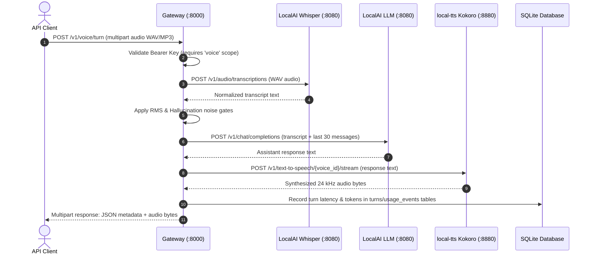

# 2. System Overview

## 2.1 Logical Architecture

The platform follows a layered, decoupled service architecture where all core inference engines communicate with the gateway over localhost loopback sockets (`127.0.0.1`), terminating behind an edge reverse proxy (Caddy).

```text
       Browser (Control Panel)               API Clients / Third-Party Apps
                 │                                        │
                 └───────────────────┬────────────────────┘
                                     │  HTTPS (443) / WSS
                                     ▼
                           Caddy Reverse Proxy
                         [Edge TLS, Basic Auth,
                          Scrubbing, Compression]
                                     │
                                     │  Loopback (127.0.0.1:8000)
                                     ▼
                          FastAPI Gateway Service
                         [Auth Scopes, Quotas, Semaphores,
                          Orchestration, Hygiene Loop]
                                     │
             ┌───────────────────────┼───────────────────────┐
             │ 127.0.0.1:8080        │ 127.0.0.1:8880        │ 127.0.0.1:8088
             ▼                       ▼                       ▼
      LocalAI Engine         local-tts Engine       Sherpa-ONNX STT
   [llama.cpp + whisper.cpp]   [Kokoro TTS Engine]   [Zipformer Streaming STT]
             │
             ▼
   SQLite (voice_platform.db)
     [WAL Mode, Pragmas, Backups]
```

---

## 2.2 Component Inventory

| Component | Port | Interface | Primary Role | Auth Mechanism | Production State |
|---|---|---|---|---|---|
| **Caddy 2** | `80`, `443` | `0.0.0.0` (Public) | Edge TLS termination, proxying, basic_auth for panel, log scrubbing | Basic Auth on `/voicecontrolpanel/*` | **[Confirmed]** |
| **FastAPI Gateway** | `8000` | `127.0.0.1` | API routing, key verification, quotas, turn orchestration, DB access | HMAC-SHA256 API Keys & Tickets | **[Confirmed]** |
| **LocalAI** | `8080` | `127.0.0.1` | LLM completions (`llama.cpp`) & batch STT (`whisper.cpp`) | Internal `LOCALAI_API_KEY` Bearer token | **[Confirmed]** |
| **local-tts** | `8880` | `127.0.0.1` | Speech synthesis via Kokoro (Metal MLX on Mac, PyTorch on Linux) | Loopback isolation + nftables | **[Confirmed]** |
| **Streaming STT** | `8088` | `127.0.0.1` | Live streaming audio transcription via Sherpa-ONNX Zipformer | Loopback isolation + nftables | **[Confirmed]** |
| **Vite Dev Server** | `5173` | `127.0.0.1` | Local development frontend hot-reloading | None (dev only) | **[Confirmed]** |

> **Security Invariant:** Internal ports (8000, 8080, 8880, 8088) **never listen on public interfaces**. They are bound strictly to `127.0.0.1` and protected by host-level firewall rules.

---

## 2.3 Voice Turn Workflow (Batch HTTP)

For non-streaming clients, a complete voice interaction executes over `POST /v1/voice/turn`:



The gateway enhances raw engine inference by adding:
- Client authentication and per-key rate limiting.
- Conversation state maintenance (last 30 messages preserved per session).
- Noise and hallucination gating (filters Whisper noise on low RMS energy).
- Intelligent fallback ("I didn't quite catch that, could you please repeat?") when speech is absent.
- Latency telemetry metrics captured per stage (`stt_ms`, `llm_ms`, `tts_ms`, `total_ms`).

---

## 2.4 Voice Turn Workflow (Real-Time WebSocket)

The real-time interactive assistant runs over `WS /v1/voice/stream`:

1. **Ticket Handshake:** The browser requests a single-use authentication ticket via `POST /v1/auth/ticket` using its API key.
2. **WebSocket Connect:** Browser connects to `WS /v1/voice/stream?ticket=<ticket>`. The ticket is consumed and validated in memory.
3. **Session Initialization:** Gateway registers the session and responds with `session.created`.
4. **VAD Speech Detection:** Client-side Silero VAD detects user vocal activity, emitting `vad.speech_start` and streaming raw 16 kHz PCM frames.
5. **Partial Transcription:** Gateway passes audio frames to Sherpa-ONNX, returning real-time `transcript.partial` events.
6. **Utterance Finalization:** User stops speaking $\rightarrow$ client emits `audio.commit` $\rightarrow$ final transcript resolved.
7. **Pipelined Generation:** Gateway queries LocalAI LLM with prompt context $\rightarrow$ emits `response.text.delta` stream.
8. **Phrase Chunking & Synthesis:** As LLM tokens arrive, the gateway cuts text into complete phrases at punctuation boundaries and dispatches them to Kokoro TTS.
9. **Audio Streaming:** Kokoro synthesizes 24 kHz audio chunks and streams them over WebSocket to the browser queue for near-zero latency playback.
10. **Barge-in / Cancellation:** If the user speaks during assistant playback, the client sends `turn.cancel`, aborting active LLM generation and audio synthesis immediately.

---

## 2.5 Audio Format Specifications

| Channel | Sample Rate | Bit Depth | Channels | Format / Codec | Maximum Size |
|---|---|---|---|---|---|
| **Microphone Input (Real-time)** | **16,000 Hz** (16 kHz) | 16-bit | Mono (1 ch) | Raw Little-Endian PCM (`pcm_s16le`) | Bounded memory buffer |
| **Batch STT Upload** | 8,000 Hz – 48,000 Hz | 16-bit | Mono/Stereo | WAV, MP3, FLAC, OGG | 20 MB (`MAX_AUDIO_UPLOAD_MB`) |
| **TTS Output Stream** | **24,000 Hz** (24 kHz) | 16-bit | Mono (1 ch) | Raw Little-Endian PCM (`pcm_s16le`) | Streaming chunks |
| **VAD Detection Window** | 16,000 Hz | 32-bit float | Mono (1 ch) | Float32 normalized (`[-1.0, 1.0]`) | 512-sample frames |

> **Critical Format Requirement:** High-quality voice interaction requires strict adherence to audio sample rates. Mismatched sample rates (e.g. 48 kHz mic input routed directly to a 16 kHz acoustic model) result in robotic, heavily distorted, or completely empty transcriptions.
