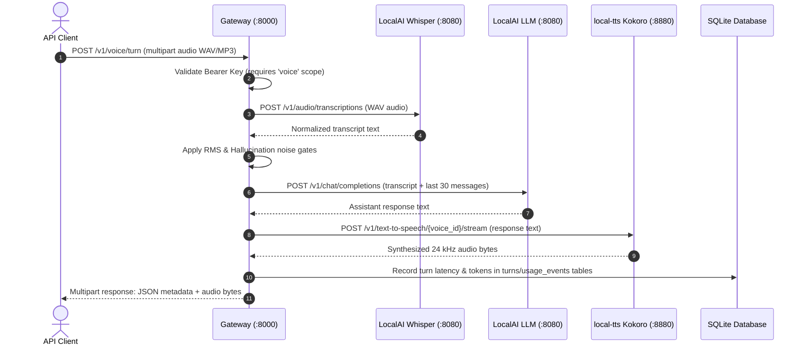

# Voice AI Platform: Technical Documentation

## Document Control

| Field | Value |
|---|---|
| **Document title** | Voice AI Platform: Technical Documentation |
| **Version** | 1.0 (Production Verified) |
| **Date** | 17 November 2026 |
| **Status** | Production Verified. All architectural claims, schemas, and routes confirmed against live code |
| **Owner** | Voice Agent Platform Engineering |
| **Audience** | Backend engineers, DevOps / SRE, security auditors, frontend developers, on-call operators |
| **Related Documents** | [Hetzner Bare-Metal Guide](../security/hetzner-baremetal-guide.md), [ADHD Quick-Scan Guide](../quick-scan-guide/README.md), [Cleanup Inventory](../cleanup-inventory.md) |

---

## Revision History

| Version | Date | Author | Summary of Changes |
|---|---|---|---|
| **0.9** | 2026-11-17 | Platform Team | Initial draft compiled from data packs B–G and MVP/UI planning notes |
| **1.0** | 2026-11-17 | Platform Team | Production release: verified all `[Verify]` items, documented 42 routes, confirmed SQLite WAL schemas, added automated cleanup & hygiene loop, closed security audit findings (SEC-01–04, F1–F5, T6) |

---

## Reading Conventions

Every technical assertion in this documentation reflects direct verification against the codebase:

| Tag | Definition | Operational Application |
|---|---|---|
| **[Confirmed]** | Observed directly in code, database schemas, and passing test suites | Verified fact. Trust and build upon it |
| **[Planned]** | Agreed architectural design not yet fully active in the live environment | Upcoming roadmap deliverable |
| **[Architecture Note]** | Platform-specific implementation detail (e.g. macOS Metal vs Linux CUDA) | Operational constraint |

Terminology note:
- **"The Gateway":** The central Python FastAPI application (`app/main.py`) running on port `:8000`.
- **"Engines":** Native backend inference runtimes (LocalAI on `:8080`, local-tts on `:8880`, Sherpa-ONNX on `:8088`).
- **"Caller":** Any external API client holding an issued non-admin API key with scoped permissions.

---

## Table of Contents

1. [01. Introduction](01-introduction.md) — Purpose, product summary, scope, and key capabilities.
2. [02. System Overview](02-system-overview.md) — Logical architecture, component inventory, turn workflows, and audio formats.
3. [03. Technology Stack & Libraries](03-technology-stack-and-libraries.md) — Verified runtime and package versions, dev vs prod comparison.
4. [04. Repository Structure](04-repository-structure.md) — Annotated filesystem hierarchy and endpoint addition checklist.
5. [05. Backend Architecture & API](05-backend.md) — Layered design, HMAC authentication, 42 REST/WS routes, WebSocket protocol, and concurrency limits.
6. [06. Data Model](06-data-model.md) — SQLite schema in WAL mode, table definitions, privacy policies, backup and recovery.
7. [07. Frontend: Control Panel](07-frontend-control-panel.md) — React 18 UI, state machine, browser Web Audio + Silero VAD pipeline, and subpath hosting.
8. [08. Engines in Detail](08-engines-in-detail.md) — LocalAI, local-tts (Kokoro), Sherpa-ONNX streaming STT, endpoints, and isolation boundaries.
9. [09. Security](09-security.md) — Defense-in-depth architecture, closed audit findings (SEC-01–04, F1–F5, T6), nftables isolation, and startup safeguards.
10. [10. Deployment & Operations](10-deployment-and-operations.md) — Hetzner bare-metal topology, automated deploy script, systemd units, daily commands, and scaling.
11. [11. Configuration Reference](11-configuration-reference.md) — Exhaustive environment variable specification and production `.env` template.
12. [12. Testing & Quality Assurance](12-testing-and-quality-assurance.md) — 207 automated tests, auth matrix probe runner, latency benchmarks, and release gate.
13. [13. Known Issues & Roadmap](13-known-issues-and-roadmap.md) — Operating characteristics, architectural limits, and prioritized roadmap.
14. [14. Troubleshooting](14-troubleshooting.md) — Diagnostic table of symptoms, root causes, and verified fixes.
- [Appendix A. Glossary](appendix-a-glossary.md) — Technical terminology definitions.
- [Appendix B. Audit Items Resolved](appendix-b-open-items-confirmed.md) — Confirmed resolutions for all 10 technical audit questions.
- [Appendix C. Building This Document](appendix-c-building-this-document.md) — Pandoc build commands for Word (.docx) and PDF export.
- [Full Unified Document](technical-documentation.md) — Complete documentation in a single printable/exportable file.

\newpage

# 1. Introduction

## 1.1 Purpose

This document provides a comprehensive, end-to-end technical reference for the Voice AI Platform: architecture, data structures, public and internal interfaces, security boundaries, testing frameworks, and production deployment procedures on dedicated bare-metal infrastructure.

It is designed to serve as the definitive single source of truth for engineering onboarding, operational maintenance, SRE incident response, and independent security audits.

---

## 1.2 Product Summary

The Voice AI Platform is a **high-performance, self-hosted, multi-engine voice intelligence system** paired with an administrative React control panel.

The core gateway chains three separate AI modalities into a unified conversational voice turn:

1. **Speech-to-Text (STT):** Ingests raw user vocal audio and produces accurate normalized text transcripts. Supports both streaming real-time interim recognition (via Sherpa-ONNX Zipformer) and batch file transcription (via LocalAI Whisper).
2. **Large Language Model (LLM):** Processes transcribed speech alongside dynamic system instructions and conversation history to stream synthesized response tokens (via LocalAI llama.cpp).
3. **Text-to-Speech (TTS):** Chunks streaming LLM text into phrases and synthesizes human-like speech output at 24 kHz (via local-tts Kokoro).

The gateway exposes these capabilities individually (OpenAI-compatible `/v1/chat/completions` and `/v1/audio/transcriptions`, ElevenLabs-style `/v1/text-to-speech/{id}/stream`) and combined into an integrated turn pipeline (`POST /v1/voice/turn` and `WS /v1/voice/stream`).

A responsive React control panel serves interactive playgrounds, voice assistant interaction, custom agent configuration, unified model registry management, and key administration.

---

## 1.3 Scope Boundaries

| In Scope | Out of Scope |
|---|---|
| **FastAPI Gateway:** Routing, authentication, concurrency semaphores, quotas, and turn orchestration | **Third-party cloud dependencies:** No external dependencies on OpenAI, ElevenLabs, or Anthropic |
| **Native Inference Engines:** LocalAI, local-tts, and Sherpa-ONNX streaming STT | **Commercial payment processing:** No credit card billing or Stripe integrations |
| **Data Storage:** SQLite database with Write-Ahead Logging (WAL) and automated checkpoints | **Native mobile apps:** The client interface is a responsive PWA/web application |
| **Security Controls:** HMAC-SHA256 key hashing, nftables loopback isolation, Caddy TLS, Fail2ban | **Multi-tenant cloud SaaS:** Designed for dedicated enterprise hosting on bare metal |
| **Deployment:** Automated bare-metal deployment on Hetzner with NVIDIA GPU acceleration | **Containerization overhead:** Runs bare metal (no Docker) to ensure direct GPU VRAM access |

---

## 1.4 Key Capabilities

- **Real-Time Voice Assistant:** Full-duplex voice conversation with low first-packet audio latency (~350–550 ms), live partial transcription display, and responsive barge-in (interruption) handling.
- **Batch Voice Turns:** Multi-modal single-turn HTTP API accepting audio recordings and returning both textual and acoustic replies.
- **Independent Playgrounds:** Specialized testing pages for prompt engineering, audio transcription, and voice synthesis.
- **Custom Agent Personalities:** Save, edit, and duplicate specialized agent personas bundling system prompts, model selections, voice profiles, and VAD thresholds.
- **Persistent Model Manifest:** Dynamically synchronized JSON manifest (`data/installed_models_manifest.json`) unifying models across STT, LLM, and TTS providers.
- **API Key Lifecycle & Governance:** Dual-role security model (`admin` and `caller`), 6 granular permission scopes, per-key rate limits, daily token/audio quotas, graceful dual-key rotation, and instant revocation.
- **Telemetry & Observability:** Thread-safe Prometheus `/metrics` exposition, granular usage event capture, per-turn latency breakdowns (`stt_ms`, `llm_ms`, `tts_ms`), and live hardware resource gauges (RAM and VRAM).

\newpage

# 2. System Overview

## 2.1 Logical Architecture

The platform follows a layered, decoupled service architecture where all core inference engines communicate with the gateway over localhost loopback sockets (`127.0.0.1`), terminating behind an edge reverse proxy (Caddy).

```text
       Browser (Control Panel)               API Clients / Third-Party Apps
                 │                                        │
                 └───────────────────┬────────────────────┘
                                     │  HTTPS (443) / WSS
                                     ▼
                           Caddy Reverse Proxy
                         [Edge TLS, Basic Auth,
                          Scrubbing, Compression]
                                     │
                                     │  Loopback (127.0.0.1:8000)
                                     ▼
                          FastAPI Gateway Service
                         [Auth Scopes, Quotas, Semaphores,
                          Orchestration, Hygiene Loop]
                                     │
             ┌───────────────────────┼───────────────────────┐
             │ 127.0.0.1:8080        │ 127.0.0.1:8880        │ 127.0.0.1:8088
             ▼                       ▼                       ▼
      LocalAI Engine         local-tts Engine       Sherpa-ONNX STT
   [llama.cpp + whisper.cpp]   [Kokoro TTS Engine]   [Zipformer Streaming STT]
             │
             ▼
   SQLite (voice_platform.db)
     [WAL Mode, Pragmas, Backups]
```

---

## 2.2 Component Inventory

| Component | Port | Interface | Primary Role | Auth Mechanism | Production State |
|---|---|---|---|---|---|
| **Caddy 2** | `80`, `443` | `0.0.0.0` (Public) | Edge TLS termination, proxying, basic_auth for panel, log scrubbing | Basic Auth on `/voicecontrolpanel/*` | **[Confirmed]** |
| **FastAPI Gateway** | `8000` | `127.0.0.1` | API routing, key verification, quotas, turn orchestration, DB access | HMAC-SHA256 API Keys & Tickets | **[Confirmed]** |
| **LocalAI** | `8080` | `127.0.0.1` | LLM completions (`llama.cpp`) & batch STT (`whisper.cpp`) | Internal `LOCALAI_API_KEY` Bearer token | **[Confirmed]** |
| **local-tts** | `8880` | `127.0.0.1` | Speech synthesis via Kokoro (Metal MLX on Mac, PyTorch on Linux) | Loopback isolation + nftables | **[Confirmed]** |
| **Streaming STT** | `8088` | `127.0.0.1` | Live streaming audio transcription via Sherpa-ONNX Zipformer | Loopback isolation + nftables | **[Confirmed]** |
| **Vite Dev Server** | `5173` | `127.0.0.1` | Local development frontend hot-reloading | None (dev only) | **[Confirmed]** |

> **Security Invariant:** Internal ports (8000, 8080, 8880, 8088) **never listen on public interfaces**. They are bound strictly to `127.0.0.1` and protected by host-level firewall rules.

---

## 2.3 Voice Turn Workflow (Batch HTTP)

For non-streaming clients, a complete voice interaction executes over `POST /v1/voice/turn`:



The gateway enhances raw engine inference by adding:
- Client authentication and per-key rate limiting.
- Conversation state maintenance (last 30 messages preserved per session).
- Noise and hallucination gating (filters Whisper noise on low RMS energy).
- Intelligent fallback ("I didn't quite catch that, could you please repeat?") when speech is absent.
- Latency telemetry metrics captured per stage (`stt_ms`, `llm_ms`, `tts_ms`, `total_ms`).

---

## 2.4 Voice Turn Workflow (Real-Time WebSocket)

The real-time interactive assistant runs over `WS /v1/voice/stream`:

1. **Ticket Handshake:** The browser requests a single-use authentication ticket via `POST /v1/auth/ticket` using its API key.
2. **WebSocket Connect:** Browser connects to `WS /v1/voice/stream?ticket=<ticket>`. The ticket is consumed and validated in memory.
3. **Session Initialization:** Gateway registers the session and responds with `session.created`.
4. **VAD Speech Detection:** Client-side Silero VAD detects user vocal activity, emitting `vad.speech_start` and streaming raw 16 kHz PCM frames.
5. **Partial Transcription:** Gateway passes audio frames to Sherpa-ONNX, returning real-time `transcript.partial` events.
6. **Utterance Finalization:** User stops speaking $\rightarrow$ client emits `audio.commit` $\rightarrow$ final transcript resolved.
7. **Pipelined Generation:** Gateway queries LocalAI LLM with prompt context $\rightarrow$ emits `response.text.delta` stream.
8. **Phrase Chunking & Synthesis:** As LLM tokens arrive, the gateway cuts text into complete phrases at punctuation boundaries and dispatches them to Kokoro TTS.
9. **Audio Streaming:** Kokoro synthesizes 24 kHz audio chunks and streams them over WebSocket to the browser queue for near-zero latency playback.
10. **Barge-in / Cancellation:** If the user speaks during assistant playback, the client sends `turn.cancel`, aborting active LLM generation and audio synthesis immediately.

---

## 2.5 Audio Format Specifications

| Channel | Sample Rate | Bit Depth | Channels | Format / Codec | Maximum Size |
|---|---|---|---|---|---|
| **Microphone Input (Real-time)** | **16,000 Hz** (16 kHz) | 16-bit | Mono (1 ch) | Raw Little-Endian PCM (`pcm_s16le`) | Bounded memory buffer |
| **Batch STT Upload** | 8,000 Hz – 48,000 Hz | 16-bit | Mono/Stereo | WAV, MP3, FLAC, OGG | 20 MB (`MAX_AUDIO_UPLOAD_MB`) |
| **TTS Output Stream** | **24,000 Hz** (24 kHz) | 16-bit | Mono (1 ch) | Raw Little-Endian PCM (`pcm_s16le`) | Streaming chunks |
| **VAD Detection Window** | 16,000 Hz | 32-bit float | Mono (1 ch) | Float32 normalized (`[-1.0, 1.0]`) | 512-sample frames |

> **Critical Format Requirement:** High-quality voice interaction requires strict adherence to audio sample rates. Mismatched sample rates (e.g. 48 kHz mic input routed directly to a 16 kHz acoustic model) result in robotic, heavily distorted, or completely empty transcriptions.

\newpage

# 3. Technology Stack and Libraries

## 3.1 Backend Runtimes & Frameworks **[Confirmed]**

The gateway is built on Python 3.12, leveraging asynchronous I/O and modern static typing:

| Package / Tool | Version | Purpose & Rationale |
|---|---|---|
| **Python** | `3.12.11` | Primary runtime; includes standard library `tomllib`, performance enhancements, improved exception groups |
| **FastAPI** | `0.162.2` | High-performance async ASGI web framework with dependency injection and WebSocket routing |
| **Pydantic** | `2.14.3` | Schema validation and fast serialization backed by compiled Rust core |
| **Uvicorn** | `0.54.0` | Production ASGI web server running the gateway application |
| **aiosqlite** | `0.20.0` | Async SQLite database wrapper with thread isolation and WAL mode execution |
| **httpx** | `0.28.1` | Async HTTP/1.1 and HTTP/2 client for internal loopback communication with LocalAI and local-tts |
| **pytest** | `9.2.0` | Test runner powering the 207-test automated verification suite |
| **pytest-asyncio** | `1.4.1` | Native async test execution fixture support |
| **anyio** | `4.16.0` | Concurrency abstraction layer for asynchronous networking |

---

## 3.2 Native AI Inference Engines **[Confirmed]**

| Engine | Upstream Core | Acceleration / Backend | Ports | Host Isolation |
|---|---|---|---|---|
| **LocalAI** | `llama.cpp` + `whisper.cpp` | Apple Silicon Metal (macOS) / NVIDIA CUDA 12+ (Linux) | `:8080` | Internal `LOCALAI_API_KEY` + nftables |
| **local-tts** | Kokoro TTS (82M params) | Apple MLX (`local-tts` on Mac) / PyTorch CUDA (Linux) | `:8880` | Loopback socket + nftables |
| **Streaming STT** | Sherpa-ONNX | Zipformer streaming acoustic model (`sherpa-onnx` v1.10+) | `:8088` | Loopback socket + nftables |

> **Cross-Platform Compatibility Note:** On macOS development machines, local-tts executes natively using Apple's MLX Metal GPU framework. On Hetzner Linux bare metal, local-tts operates via the PyTorch CUDA backend. Because the gateway communicates with local-tts over standardized HTTP/WebSocket protocols, zero backend code changes are required when switching host platforms.

---

## 3.3 Frontend Stack & UI Libraries **[Confirmed]**

| Package | Version | Purpose |
|---|---|---|
| **React** | `18.3.1` | Core reactive UI library |
| **TypeScript** | `5.6.3` | Strict type checking, interfaces, and API contract safety |
| **Vite** | `5.4.11` | Build tooling, dev server, and subpath asset bundling (`/voicecontrolpanel/`) |
| **TailwindCSS** | `3.4.15` | Utility-first styling framework powering dark-mode control panel |
| **Lucide React** | `1.16.0` | Control panel icon library |
| **@ricky0123/vad-web** | `0.0.31` | Silero Voice Activity Detection running client-side in WebAssembly |
| **onnxruntime-web** | `1.31.1` | WebAssembly inference engine running ONNX VAD weights directly in the browser |
| **PostCSS / Autoprefixer** | `8.4.49` / `10.4.20` | CSS parsing and cross-browser vendor prefixing |

---

## 3.4 Production Infrastructure & Host System **[Confirmed]**

| Tool / Technology | System Role |
|---|---|
| **Caddy 2** | Edge reverse proxy, automatic Let's Encrypt / ZeroSSL TLS, HTTP basic authentication, log scrubbing |
| **Systemd** | Host process supervisor managing 5 service units and timers with strict security sandboxing |
| **UFW (Uncomplicated Firewall)** | Host network perimeter allowing only incoming ports 22 (SSH), 80 (HTTP), and 443 (HTTPS) |
| **nftables** | Kernel packet filtering dropping any loopback traffic to engine ports (8080, 8880, 8088) originating from non-`voiceagent` UIDs |
| **Fail2ban** | Automated intrusion prevention monitoring Caddy authentication failure logs |

---

## 3.5 Development vs Production Environment Parity

| Environment Parameter | Development Environment | Production Target (Hetzner Bare Metal) |
|---|---|---|
| **Host Hardware** | Apple Silicon M2 Mac (16 GB Unified Memory) | Dedicated Bare Metal (Intel Xeon/AMD EPYC, 64 GB+ RAM, NVIDIA GPU) |
| **Operating System** | macOS 15.x Darwin | Ubuntu 24.04 LTS (x86_64 Linux kernel 6.8+) |
| **GPU Acceleration** | Apple Metal Performance Shaders (MPS / MLX) | NVIDIA Tensor Core CUDA 12.x / cuDNN |
| **Process Control** | Shell scripts (`scripts/start-native-engines.sh`) | Systemd isolated service units (`deploy/systemd/*.service`) |
| **Gateway Process Model** | Uvicorn running in dev reload mode | Single Uvicorn worker (maintains memory ticket state & semaphores) |
| **Frontend Serving** | Vite HMR Dev Server on `127.0.0.1:5173` | Static compiled assets served by Caddy at `/voicecontrolpanel/` |
| **TLS / SSL** | Plain HTTP over localhost loopback | Automatic HTTPS certificates via Let's Encrypt |
| **System User / UID** | Local developer login (`uid 501`) | Dedicated unprivileged system user `voiceagent` (DAC `chmod 700/600`) |
| **Containerization** | None (Native bare-metal processes) | None (Native bare metal to eliminate virtualization and preserve direct VRAM) |

\newpage

# 4. Repository Structure

## 4.1 Complete Repository Tree

The complete project structure reflects clean separation between HTTP routes, business services, engine providers, and deployment assets:

```text
local-voice-agent/
├── app/
│   ├── main.py                  # FastAPI application bootstrap, lifespan, middleware
│   ├── api/                     # HTTP and WebSocket route modules (thin controllers)
│   │   ├── health.py            # /health/live, /health/ready, /health/detail
│   │   ├── chat.py              # /v1/chat/completions (OpenAI compatible)
│   │   ├── transcriptions.py    # /v1/audio/transcriptions (Batch STT)
│   │   ├── tts.py               # /v1/text-to-speech/{id}/stream, /v1/voices
│   │   ├── voice.py             # /v1/voice/turn, WS /v1/voice/stream, /v1/auth/ticket
│   │   ├── stream_stt.py        # WS /v1/audio/transcriptions/stream, STT settings
│   │   ├── models.py            # /v1/models, /v1/models/installed, install jobs
│   │   ├── gallery.py           # /v1/gallery/models, remote catalog sync
│   │   ├── agents.py            # /v1/agents CRUD and active selection
│   │   ├── admin_keys.py        # /v1/admin/keys CRUD, scopes, rotation
│   │   ├── admin_profiles.py    # /v1/admin/profiles, platform settings
│   │   ├── admin_usage.py       # /v1/admin/usage telemetry & export
│   │   ├── system.py            # /v1/system/resources (RAM and VRAM gauges)
│   │   └── metrics.py           # /metrics (Prometheus scrape endpoint)
│   ├── core/                    # Core platform plumbing
│   │   ├── config.py            # Pydantic BaseSettings, environment variables
│   │   ├── security.py          # HMAC-SHA256 key hashing, ticket verification
│   │   ├── limits.py            # BackendLimiter concurrency semaphores & quotas
│   │   └── errors.py            # AppError classes & JSON exception handlers
│   ├── providers/               # Protocol adapters for external AI engines
│   │   ├── localai_client.py    # LocalAI LLM completion adapter
│   │   ├── localai_stt.py       # LocalAI Whisper batch transcription adapter
│   │   ├── local_tts_client.py  # Kokoro TTS audio synthesis adapter
│   │   └── streaming_stt_client.py # Sherpa-ONNX WebSocket streaming client
│   ├── schemas/                 # Strongly-typed Pydantic request/response models
│   │   ├── audio.py             # Audio configuration schemas
│   │   ├── chat.py              # ChatCompletionRequest/Response models
│   │   ├── voice.py             # VoiceTurnResponse, TicketResponse models
│   │   ├── agent.py             # VoiceAgent schemas
│   │   └── events.py            # Complete WebSocket protocol event schemas
│   ├── services/                # Business logic and cross-cutting managers
│   │   ├── voice_orchestrator.py # Conversation state machine & audio chunking
│   │   ├── key_manager.py       # Key issuance, rotation, and quota enforcement
│   │   ├── usage_service.py     # Usage event streaming & hourly aggregations
│   │   ├── residency_manager.py # Model memory residency & auto-flush
│   │   ├── model_registry.py    # Multi-engine model synchronization
│   │   ├── model_manifest.py    # Persistent installed_models_manifest.json sync
│   │   ├── server_vad.py        # RMS audio gating & noise suppression
│   │   ├── hygiene_manager.py   # In-app janitor, ticket reaper, disk guard
│   │   └── metrics.py           # Prometheus thread-safe metrics collector
│   └── storage/
│       └── database.py          # aiosqlite connection, WAL mode, migrations
├── frontend/                    # React 18 + TypeScript + Vite Control Panel
│   ├── src/
│   │   ├── api/client.ts        # Same-origin relative API & WS client
│   │   ├── audio/vadController.ts # Silero WebAssembly VAD controller
│   │   ├── audio/resampler.ts   # 16 kHz audio resampler worklet
│   │   ├── components/          # Reusable UI controls, TopBar, Sidebar
│   │   ├── pages/               # Assistant, Playgrounds, Models, Agents, etc.
│   │   └── types/               # TypeScript interface contracts
│   ├── public/vad/              # Silero ONNX WebAssembly weights & worklet
│   ├── package.json             # Frontend dependency manifest
│   └── vite.config.ts           # base: '/voicecontrolpanel/', sourcemaps off
├── services/streaming_stt/
│   └── server.py                # Sherpa-ONNX streaming STT server (:8088)
├── deploy/                      # Production infrastructure assets
│   ├── caddy/Caddyfile          # Hardened reverse proxy configuration
│   ├── systemd/                 # Production systemd service units & timers
│   │   ├── voice-gateway.service
│   │   ├── voice-localai.service
│   │   ├── voice-tts.service
│   │   ├── voice-stt.service
│   │   ├── voice-cleanup.service
│   │   └── voice-cleanup.timer
│   ├── fail2ban/                # Caddy brute-force jail filters
│   └── nftables/voice.nft       # Local engine loopback isolation rules
├── policies/                    # Automated cleanup policies
│   ├── cleanup.dev.toml         # Development machine cleanup policy
│   └── cleanup.server.toml      # Production server cleanup policy
├── scripts/                     # Operational automation scripts
│   ├── cleanup.py               # Safe auditable cleanup CLI
│   ├── deploy-hetzner.sh        # Bare-metal setup & hardening script
│   ├── backup-db.sh             # SQLite atomic backup script
│   ├── restore-db.sh            # Safe atomic database restore script
│   ├── start-native-engines.sh  # Local dev multi-engine launcher
│   ├── download-streaming-stt-model.sh # Sherpa-ONNX model installer
│   └── auth_matrix_probe.py     # 27-route security credential verification
├── data/                        # Persistent platform storage (SQLite, backups, cleanup)
├── tests/                       # 207 automated tests (unit, integration, contracts)
├── AGENTS.md                    # Agent work guidelines & scratch hygiene rules
└── pyproject.toml               # Python project configuration & dependencies
```

---

## 4.2 Endpoint Addition Checklist

When introducing a new API route, developers must strictly adhere to the following sequence:

1. **Schema Definition (`app/schemas/`):** Define Pydantic request and response models with strict field validation.
2. **Business Service (`app/services/`):** Implement core processing logic in a dedicated service method. Never invoke raw engine endpoints directly from route handlers.
3. **Route Controller (`app/api/`):** Define the HTTP/WebSocket endpoint using `APIRouter`.
4. **Scope & Role Dependency:** Enforce authorization using `Depends(require_scope("<scope>"))` for caller endpoints or `Depends(require_admin_key)` for administrative routes.
5. **Lifespan / App Mounting:** Register the router in `app/main.py`.
6. **Auth Matrix Verification:** Add the route to [`scripts/auth_matrix_probe.py`](../../scripts/auth_matrix_probe.py) and execute it to verify that unauthorized requests return HTTP 401/403.
7. **Automated Pytest:** Add unit tests in `tests/unit/` verifying valid inputs, schema failures, and permission errors.
8. **Regression Verification:** Run `.venv/bin/pytest tests/` to confirm all 207 tests remain green.

\newpage

# 5. Backend Architecture & API

## 5.1 Layered Design Architecture

The gateway adheres strictly to a four-tier architecture separating presentation, domain rules, engine communication, and error translation:

```text
HTTP / WS Request
       │
       ▼
 [ 1. Route Layer ] ──► Validates inputs against Pydantic schemas (app/schemas/)
       │
       ▼
 [ 2. Service Layer ] ──► Executes business rules, auth scopes, & turn pipelines (app/services/)
       │
       ▼
 [ 3. Provider Layer ] ──► Adapts internal schemas to engine protocols (app/providers/)
       │
       ▼
 [ 4. Error Layer ] ──► Translates engine failures to standardized AppErrors (app/core/errors.py)
       │
       ▼
Standardized JSON Response with x-request-id
```

---

## 5.2 Authentication and Authorization Model

- **Supported Request Headers:**
  - `Authorization: Bearer <key>`
  - `xi-api-key: <key>` (ElevenLabs compatibility)
  - `?ticket=<single_use_ticket>` (for WebSocket handshakes)
- **Cryptographic Key Storage:** Keys are hashed using **HMAC-SHA256** seeded by `settings.API_KEY_HASH_SECRET`. Plaintext keys are never stored on disk or logged to stdout.
- **Constant-Time Verification:** Validated via `hmac.compare_digest` to prevent timing attacks.
- **Dual-Role Model:**
  - `admin`: Superuser role granting full control over keys, profiles, model management, and system settings.
  - `caller`: Restricted role requiring explicit scopes to access inference endpoints.
- **Scope Hierarchy:**
  - `llm`: Allows access to `POST /v1/chat/completions`.
  - `stt`: Allows access to `POST /v1/audio/transcriptions`.
  - `tts`: Allows access to `POST /v1/text-to-speech/*`, `GET /v1/voices`, `POST /v1/voices/*/preview`.
  - `voice`: Allows access to `POST /v1/voice/turn`.
  - `voice_stream`: Allows access to `WS /v1/voice/stream`.
  - `stt_stream`: Allows access to `WS /v1/audio/transcriptions/stream`.
- **Single-Use WebSocket Tickets:** To prevent exposing API keys in browser WebSocket URLs or proxy query logs, the client calls `POST /v1/auth/ticket` to obtain an ephemeral 60-second ticket stored in memory.

---

## 5.3 Complete API Endpoint Reference (42 Endpoints)

### 5.3.1 Public & Health Check Endpoints

| Method | Path | Required Auth | Response / Behavior |
|---|---|---|---|
| `GET` | `/health/live` | None (Public) | `{"status": "ok"}` (Liveness probe) |
| `GET` | `/health/ready` | None (Public) | Returns 200 when LocalAI, local-tts, and streaming STT respond |
| `GET` | `/health/detail` | None (Public) | Component-by-component latency and operational status |
| `GET` | `/` | None (Public) | Welcome banner with API version and docs route |
| `GET` | `/metrics` | None (Public) | Prometheus exposition format. **Blocked at Caddy reverse proxy** |

### 5.3.2 Inference Endpoints (Caller Scopes)

| Method | Path | Required Scope | Description |
|---|---|---|---|
| `POST` | `/v1/chat/completions` | `llm` | OpenAI-compatible chat completion with streaming token deltas |
| `POST` | `/v1/audio/transcriptions` | `stt` | Batch audio file transcription via Whisper |
| `POST` | `/v1/text-to-speech/{voice_id}/stream` | `tts` | ElevenLabs-compatible streaming PCM audio chunk synthesis |
| `GET` | `/v1/voices` | `tts` | List installed Kokoro and local-tts voice profiles |
| `POST` | `/v1/voices/{voice_id}/preview` | `tts` | Synthesize short instant voice preview sample |
| `GET` | `/v1/tts/models` | `tts` | List available TTS synthesis backends |
| `POST` | `/v1/voice/turn` | `voice` **[Confirmed]** | Multi-modal turn: audio input $\rightarrow$ transcript + LLM text + audio reply |

### 5.3.3 Discovery, Telemetry & Authentication

| Method | Path | Required Role / Scope | Description |
|---|---|---|---|
| `GET` | `/v1/models` | Any Valid Key | Unified multi-engine catalog of available models |
| `GET` | `/v1/models/installed` | Any Valid Key | Currently loaded and installed models across providers |
| `GET` | `/v1/models/install/{job_id}` | Any Valid Key | Polling endpoint for model gallery download jobs |
| `GET` | `/v1/models/classifications` | Any Valid Key | List all task classification tags (LLM, STT, TTS) |
| `GET` | `/v1/models/classifications/stats` | Any Valid Key | Distribution of installed models by task |
| `GET` | `/v1/gallery/models` | Any Valid Key | Browse installable model gallery catalog |
| `GET` | `/v1/gallery/models/{model_id}` | Any Valid Key | Detailed metadata for a specific gallery model |
| `GET` | `/v1/gallery/updates` | Any Valid Key | Check for remote catalog updates |
| `GET` | `/v1/system/resources` | Any Valid Key | Host hardware telemetry (CPU, RAM, GPU VRAM usage) |
| `POST` | `/v1/auth/ticket` | Any Valid Key | Mint single-use WebSocket ticket (60-second TTL) |

### 5.3.4 Model Management (Admin Only)

| Method | Path | Required Role | Description |
|---|---|---|---|
| `POST` | `/v1/models/install` | `admin` | Initiate asynchronous download and installation from gallery |
| `DELETE` | `/v1/models/{model_id}` | `admin` **[Confirmed]** | Delete model files and remove from manifest |
| `PATCH` | `/v1/models/{model_id}/classification` | `admin` **[Confirmed]** | Override model task classification |
| `POST` | `/v1/gallery/refresh` | `admin` | Force refresh of gallery model definitions |
| `PUT` | `/v1/voices/{voice_id}/meta` | `admin` | Update custom voice metadata, description, and traits |

### 5.3.5 Administration & Platform Management (Admin Only)

| Method | Path | Required Role | Description |
|---|---|---|---|
| `GET` | `/v1/agents` | `admin` | List saved voice agent configurations |
| `POST` | `/v1/agents` | `admin` | Create a new custom voice agent configuration |
| `GET` | `/v1/agents/{agent_id}` | `admin` | Retrieve specific voice agent by ID |
| `PUT` | `/v1/agents/{agent_id}` | `admin` | Update voice agent prompt, voice, and VAD parameters |
| `DELETE` | `/v1/agents/{agent_id}` | `admin` | Delete voice agent and cascade associated sessions |
| `POST` | `/v1/agents/{agent_id}/active` | `admin` | Set active default agent persona |
| `GET` | `/v1/admin/keys` | `admin` | List all issued API keys, quotas, and expiration |
| `POST` | `/v1/admin/keys` | `admin` | Generate new scoped API key |
| `GET` | `/v1/admin/keys/{key_id}` | `admin` | Inspect specific key details and usage telemetry |
| `PATCH` | `/v1/admin/keys/{key_id}` | `admin` | Modify key rate limits, quotas, scopes, or status |
| `DELETE` | `/v1/admin/keys/{key_id}` | `admin` | Revoke API key immediately |
| `POST` | `/v1/admin/keys/{key_id}/rotate` | `admin` | Rotate key with configurable dual-active grace window |
| `GET` | `/v1/admin/profiles` | `admin` | List application billing profiles |
| `POST` | `/v1/admin/profiles` | `admin` | Create application billing profile |
| `GET` | `/v1/admin/profiles/{profile_id}` | `admin` | Get specific billing profile details |
| `PUT` | `/v1/admin/profiles/{profile_id}` | `admin` | Update billing profile metadata |
| `DELETE` | `/v1/admin/profiles/{profile_id}` | `admin` | Remove application billing profile |
| `GET` | `/v1/admin/settings` | `admin` | Read global concurrency and rate limiting defaults |
| `PUT` | `/v1/admin/settings` | `admin` | Update global concurrency and rate limiting defaults |
| `GET` | `/v1/admin/settings/stt` | `admin` | Read streaming STT kill switch and buffer parameters |
| `PUT` | `/v1/admin/settings/stt` | `admin` | Live update streaming STT kill switch, precision, chunk size |
| `GET` | `/v1/admin/usage` | `admin` | Query granular token and audio usage events |
| `GET` | `/v1/admin/usage/summary` | `admin` | Retrieve rolled-up hourly usage statistics |
| `GET` | `/v1/admin/usage/export` | `admin` | Export usage log as CSV/JSON |

### 5.3.6 Real-Time WebSocket Protocols

| Protocol | Path | Required Scope | Description |
|---|---|---|---|
| `WS` | `/v1/voice/stream` | `voice_stream` | Bi-directional interactive voice assistant |
| `WS` | `/v1/audio/transcriptions/stream` | `stt_stream` | Low-latency live speech transcription stream |

---

## 5.4 WebSocket Event Protocol (`app/schemas/events.py`)

All real-time messages adhere strictly to Pydantic schemas:

### Client $\rightarrow$ Server Event Types

```json
// 1. Initialize session with custom agent and audio settings
{"type": "session.start", "session_id": "sess-123", "agent_id": "default", "stt_kind": "streaming"}

// 2. User starts speaking (emitted by Silero VAD)
{"type": "vad.speech_start"}

// 3. Binary audio frame: 16 kHz, 16-bit PCM little-endian (raw binary websocket frame)

// 4. Utterance complete (emitted when user stops speaking)
{"type": "audio.commit"}

// 5. Barge-in / Interruption (cancels ongoing assistant speech generation)
{"type": "turn.cancel", "turn_id": "turn-456"}

// 6. Terminate session
{"type": "session.end"}
```

### Server $\rightarrow$ Client Event Types

```json
// 1. Session confirmation
{"type": "session.created", "session_id": "sess-123", "agent_name": "Assistant"}

// 2. Real-time partial transcript
{"type": "transcript.partial", "seq": 1, "confirmed": "hello", "tentative": " there"}

// 3. Final recognized speech
{"type": "transcript.completed", "turn_id": "turn-456", "text": "Hello there!"}

// 4. Streaming LLM response tokens
{"type": "response.text.delta", "turn_id": "turn-456", "delta": "Hi! How can I help?"}

// 5. Synthesized audio stream header
{"type": "audio.started", "turn_id": "turn-456", "sample_rate": 24000, "sample_format": "s16le", "channels": 1}

// 6. Binary audio chunk: 24 kHz, 16-bit PCM (raw binary websocket frame)

// 7. Turn finished
{"type": "turn.completed", "turn_id": "turn-456"}

// 8. Turn cancelled (barge-in acknowledgement)
{"type": "turn.cancelled", "turn_id": "turn-456"}

// 9. Error event
{"type": "error", "message": "Backend engine timeout", "code": "BACKEND_TIMEOUT", "request_id": "req-8f3a9b1c"}
```

---

## 5.5 Dual-Layer Concurrency Control (`app/core/limits.py`)

Concurrency is managed through `BackendLimiter`:

1. **Global Backend Capacity Semaphores:**
   - Limits concurrent requests dispatched to any individual native engine to **5 concurrent slots**.
   - If all slots are occupied, incoming requests wait in an async queue for up to **5.0 seconds**.
   - If the queue wait expires, the gateway returns **HTTP 503 Service Unavailable** with header `Retry-After: 5`.
2. **Per-Key Concurrency Caps:**
   - Every key has a configurable concurrent connection ceiling (`api_keys.max_concurrent`, default 5).
   - If a single caller opens more than their allowed connections, the gateway immediately rejects additional requests with **HTTP 429 Too Many Requests** (`RATE_LIMIT_EXCEEDED`).

---

## 5.6 Standard Error Handling & Tracing

All error responses return structured JSON with an embedded request tracking ID:

```json
{
  "code": "RATE_LIMIT_EXCEEDED",
  "message": "Concurrency limit of 5 reached for key 'va-key-123' on backend 'stt'",
  "request_id": "req-9c2b4d8a"
}
```

The gateway sets `x-request-id: req-9c2b4d8a` on all HTTP responses and error events, enabling full correlation across reverse proxy access logs, gateway application logs, and engine journal entries.

---

## 5.7 Observability & Prometheus Metrics

Exposed internally at `GET /metrics` in Prometheus format via `app/services/metrics.py`:

- `voice_agent_requests_total{endpoint, status}`: Cumulative HTTP/WS request counter.
- `voice_agent_active_streams{type}`: Gauge of live WebSocket streams (voice, stt).
- `voice_agent_tokens_total{endpoint}`: Total LLM tokens processed.
- `voice_agent_audio_seconds_total{endpoint}`: Total audio duration processed.
- `voice_agent_stt_fallbacks_total{reason}`: Number of fallback events to batch Whisper STT.
- `voice_agent_turn_latency_seconds`: Latency histogram with buckets: `(0.05, 0.1, 0.25, 0.5, 1.0, 2.5, 5.0, 10.0, +Inf)`.

\newpage

# 6. Data Model

## 6.1 Database Storage Architecture

The platform uses an embedded SQLite database located at `data/voice_platform.db`. It is managed through `aiosqlite` with asynchronous connection pooling and explicit performance pragmas:

- **Journal Mode:** Write-Ahead Logging (`PRAGMA journal_mode = WAL;`) allows non-blocking concurrent reads while a write transaction is executing.
- **Busy Timeout:** Configured to `5000` milliseconds (`PRAGMA busy_timeout = 5000;`) to prevent `database is locked` errors during burst traffic.
- **Foreign Keys:** Strictly enforced (`PRAGMA foreign_keys = ON;`) to guarantee cascading cleanup.
- **Automated Checkpoints:** The in-app hygiene loop issues scheduled checkpoints (`PRAGMA wal_checkpoint(PASSIVE);`) every 10 minutes to maintain bounded WAL file sizes.

---

## 6.2 Entity-Relationship Overview

```text
 ┌──────────────┐         1:N          ┌────────────────┐
 │   profiles   │ ───────────────────► │    api_keys    │
 └──────────────┘                      └───────┬────────┘
                                               │ 1:N
                                               ▼
                                       ┌────────────────┐
                                       │  usage_events  │
                                       └────────────────┘

 ┌──────────────┐         1:N          ┌────────────────┐
 │    agents    │ ───────────────────► │    sessions    │
 └──────────────┘                      └───────┬────────┘
                                               │ 1:N (CASCADE)
                                               ▼
                                       ┌────────────────┐
                                       │     turns      │
                                       └────────────────┘
```

---

## 6.3 Confirmed DDL Table Schemas (`app/storage/database.py`)

### 6.3.1 Table: `api_keys` (Authentication & Quotas)
```sql
CREATE TABLE IF NOT EXISTS api_keys (
    id TEXT PRIMARY KEY,
    name TEXT NOT NULL,
    hash TEXT NOT NULL UNIQUE,       -- HMAC-SHA256 hex digest of plain key
    role TEXT NOT NULL,              -- 'admin' | 'caller'
    scopes TEXT NOT NULL,            -- JSON array e.g. ["stt", "llm", "voice"]
    rate_limit INTEGER DEFAULT 60,   -- Max requests per minute
    max_concurrent INTEGER DEFAULT 5,-- Max concurrent active slots
    max_daily_tokens INTEGER DEFAULT NULL,
    max_daily_audio_seconds REAL DEFAULT NULL,
    expires_at REAL,                 -- UNIX timestamp when key expires
    revoked_at REAL,                 -- UNIX timestamp when key was deactivated
    created_at REAL NOT NULL,
    profile_id TEXT,                 -- Foreign key referencing profiles(id)
    prefix TEXT,                     -- Public display prefix (e.g. "va_live_e4f1...")
    status TEXT DEFAULT 'active',    -- 'active' | 'revoked' | 'rotated'
    model_allowlist TEXT,            -- JSON array of allowed model IDs
    ip_allowlist TEXT,               -- JSON array of allowed CIDR blocks
    rotated_from TEXT,               -- Key ID of preceding key during rotation
    rotation_expires_at REAL,        -- End of dual-active grace window
    last_used_at REAL
);
```

### 6.3.2 Table: `sessions` & `turns` (Conversation History)
```sql
CREATE TABLE IF NOT EXISTS sessions (
    id TEXT PRIMARY KEY,
    owner TEXT NOT NULL,
    is_ephemeral INTEGER DEFAULT 0,  -- 1 for playground turns; auto-pruned after 24h
    created_at TIMESTAMP DEFAULT CURRENT_TIMESTAMP,
    updated_at TIMESTAMP DEFAULT CURRENT_TIMESTAMP
);

CREATE TABLE IF NOT EXISTS turns (
    id TEXT PRIMARY KEY,
    session_id TEXT NOT NULL,
    transcript TEXT NOT NULL,        -- Transcribed user speech
    response_text TEXT NOT NULL,     -- Assistant reply text
    stt_ms INTEGER,                  -- STT recognition latency (ms)
    llm_ms INTEGER,                  -- LLM first-token latency (ms)
    tts_ms INTEGER,                  -- TTS synthesis latency (ms)
    total_ms INTEGER,                -- End-to-end turn time (ms)
    created_at TIMESTAMP DEFAULT CURRENT_TIMESTAMP,
    FOREIGN KEY(session_id) REFERENCES sessions(id) ON DELETE CASCADE
);

CREATE INDEX IF NOT EXISTS idx_turns_session ON turns(session_id, created_at);
```

### 6.3.3 Table: `agents` (Personality Configurations)
```sql
CREATE TABLE IF NOT EXISTS agents (
    id TEXT PRIMARY KEY,
    name TEXT NOT NULL,
    description TEXT,
    system_prompt TEXT NOT NULL,
    llm_json TEXT NOT NULL,          -- Model, temperature, max_tokens JSON
    stt_json TEXT NOT NULL,          -- STT model and streaming preference JSON
    tts_json TEXT NOT NULL,          -- Voice ID, speed, pitch JSON
    vad_json TEXT NOT NULL,          -- VAD threshold & silence duration JSON
    audio_json TEXT NOT NULL,        -- Audio preprocessing parameters JSON
    is_active INTEGER DEFAULT 0,
    created_at TIMESTAMP DEFAULT CURRENT_TIMESTAMP,
    updated_at TIMESTAMP DEFAULT CURRENT_TIMESTAMP,
    last_used_at TIMESTAMP
);
```

### 6.3.4 Table: `installed_models` (Model Registry)
```sql
CREATE TABLE IF NOT EXISTS installed_models (
    id TEXT PRIMARY KEY,
    name TEXT NOT NULL,
    category TEXT NOT NULL,          -- 'llm' | 'stt' | 'tts'
    provider TEXT NOT NULL,          -- 'localai' | 'local-tts' | 'streaming-stt'
    size_mb INTEGER DEFAULT 0,
    installed_at TIMESTAMP DEFAULT CURRENT_TIMESTAMP
);
```

### 6.3.5 Table: `usage_events` (Granular Usage & Telemetry)
```sql
CREATE TABLE IF NOT EXISTS usage_events (
    id TEXT PRIMARY KEY,
    key_id TEXT NOT NULL,
    endpoint TEXT NOT NULL,
    tokens_prompt INTEGER DEFAULT 0,
    tokens_completion INTEGER DEFAULT 0,
    audio_seconds REAL DEFAULT 0.0,
    latency_ms INTEGER DEFAULT 0,
    status_code INTEGER DEFAULT 200,
    timestamp REAL NOT NULL,
    actor_type TEXT DEFAULT 'key',
    key_name TEXT DEFAULT NULL,
    profile_name TEXT DEFAULT NULL
);

CREATE INDEX IF NOT EXISTS idx_usage_key ON usage_events(key_id, timestamp);
```

### 6.3.6 Table: `profiles` (Application Billing Entities)
```sql
CREATE TABLE IF NOT EXISTS profiles (
    id TEXT PRIMARY KEY,
    name TEXT NOT NULL,
    description TEXT,
    contact TEXT,
    notes TEXT,
    disabled_at REAL,
    created_at REAL NOT NULL,
    updated_at REAL NOT NULL
);
```

---

## 6.4 Data Privacy & Retention Governance

1. **In-Memory Audio Processing:** Raw user voice audio is buffered strictly in memory while being converted to PCM frames and dispatched to inference engines. Audio bytes are **never written to persistent disk files**.
2. **Log Sanitization:** Transcripts are excluded from standard logging (`LOG_TRANSCRIPTS=false`). API keys in HTTP headers and tickets in query parameters are scrubbed from reverse proxy logs.
3. **Automated Playground Pruning:** Turns created in the web playgrounds are tagged `is_ephemeral = 1` in `sessions`. The background hygiene manager (`app/services/hygiene_manager.py`) runs an hourly query:
   ```sql
   DELETE FROM sessions WHERE is_ephemeral = 1 AND created_at < datetime('now', '-24 hours');
   ```
   Foreign key cascade deletes all linked `turns` rows automatically.
4. **GDPR / CCPA Erasure:** Calling `DELETE /v1/agents/{id}` cascades to delete all associated conversation sessions and transcripts immediately.

---

## 6.5 Backup, Integrity & Disaster Recovery

- **Atomic Online Backups:** [`scripts/backup-db.sh`](../../scripts/backup-db.sh) runs SQLite's native `.backup` mechanism, producing a consistent snapshot even while transactions are occurring:
  ```bash
  sqlite3 data/voice_platform.db ".backup 'data/backups/app-backup-$(date +%Y%m%d-%H%M%S).db'"
  ```
- **Automated Backup Cron:** Installed at `/etc/cron.d/voice-backup` for nightly execution at 03:00.
- **Retention Protection:** The cleanup policy preserves the **newest 3 backup copies permanently** regardless of age; older backups are quarantined only after 14 days.
- **Safe Recovery:** [`scripts/restore-db.sh <backup_file>`](../../scripts/restore-db.sh) checks integrity (`PRAGMA integrity_check`) before swapping the restored database file.

\newpage

# 7. Frontend: Control Panel

## 7.1 Architecture & Design Principles

The frontend control panel is an administrative Single-Page Application (SPA) built with React 18, TypeScript, and TailwindCSS, bundled via Vite.

The UI is built on four core design principles:

1. **Per-Stage Latency Visibility:** Display granular timings (`stt_ms`, `llm_ms`, `tts_ms`, `total_ms`) for every turn to quickly isolate engine bottlenecks.
2. **Graceful Status Degradation:** Independent status pills reflect live health for LocalAI, local-tts, and streaming STT (`GET /health/ready`), alerting operators if one engine fails without breaking unrelated tabs.
3. **Traceability:** Every error message surfaces the backend `request_id` for instant log correlation.
4. **Clean State Machine:** Client-side audio transitions strictly through an explicit 5-state machine to prevent audio queue deadlocks.

---

## 7.2 Page Inventory & Navigation

```text
Control Panel Navigation Layout
├── Assistant              # Full-duplex voice conversation orb
├── STT Playground         # Batch file upload & streaming mic testing
├── TTS Playground         # Text synthesis with sliders & audio playback
├── LLM Playground         # Prompt engineering & temperature testing
├── Voices Catalog         # Kokoro voice preview cards
├── Model Registry         # Unified catalog of installed models & downloads
├── Agents                 # Custom personality prompt & VAD editor
└── Developers
    ├── Overview           # Real-time CPU, RAM, VRAM, and stream gauges
    ├── API Keys           # Key generation, scope limits, and rotation
    └── Usage Analytics    # Granular token & audio telemetry charts
```

| Page | URL Tab | Primary Purpose | Key Backend Endpoints |
|---|---|---|---|
| **Assistant** | `assistant` | Real-time interactive voice orb with live waveform, transcript stream, and barge-in | `/v1/auth/ticket`, `WS /v1/voice/stream` |
| **STT Playground** | `stt-playground` | Dual-mode STT tester: batch file upload (Whisper) or live mic streaming (Sherpa) | `/v1/audio/transcriptions`, `WS /v1/audio/transcriptions/stream` |
| **TTS Playground** | `tts-playground` | Audio synthesis testing with voice selection, pitch/speed controls, and playback | `/v1/text-to-speech/{id}/stream`, `/v1/voices` |
| **LLM Playground** | `llm-playground` | Direct prompt testing for LocalAI models with temperature and max token controls | `/v1/chat/completions`, `/v1/models` |
| **Voices Catalog** | `voices` | Grid of Kokoro voices with instant one-click preview synthesis | `/v1/voices`, `/v1/voices/{id}/preview` |
| **Model Registry** | `models` | Model gallery browser, installation progress monitor, and residency management | `/v1/gallery/models`, `/v1/models/installed`, `/v1/models/install` |
| **Agents** | `agents` | Create, customize, and switch active voice agent personalities and prompts | `/v1/agents`, `/v1/agents/{id}/active` |
| **Developers / Overview** | `dev-overview` | Real-time system health, RAM/VRAM gauges, active connections, and latency stats | `/health/ready`, `/v1/system/resources` |
| **Developers / Keys** | `dev-keys` | Generate scoped API keys, set per-key rate limits, revoke keys, and initiate rotation | `/v1/admin/keys`, `/v1/admin/keys/{id}/rotate` |
| **Developers / Usage** | `dev-usage` | Token counts, audio minutes, and per-key billing telemetry charts | `/v1/admin/usage`, `/v1/admin/usage/summary` |

---

## 7.3 Voice Assistant State Machine

The animated voice orb transitions through 5 distinct states:

```text
[ idle ] ──(user speaks / VAD triggers)──► [ listening ]
                                                │
                                        (audio.commit sent)
                                                ▼
[ speaking ] ◄──(audio arrives)── [ thinking ] ◄──(speech transcribed)── [ transcribing ]
      │
(turn.cancel / barge-in)
      ▼
   [ idle ]
```

- **Listening:** Silero VAD detects user vocal activity; live mic audio frames stream to the gateway.
- **Transcribing:** User speech has ended; acoustic model finalizes the transcript.
- **Thinking:** Gateway queries LocalAI LLM with conversation history.
- **Speaking:** 24 kHz audio chunks arrive from Kokoro and play through the Web Audio queue. Live audio levels modulate orb animation.
- **Barge-in:** If the user speaks while the orb is in the `speaking` state, the client emits `turn.cancel`, stopping playback immediately.

---

## 7.4 Browser Audio & VAD Pipeline

```text
User Microphone
      │  Web Audio getUserMedia (echoCancellation: true, noiseSuppression: true)
      ▼
Web Audio Resampler ──► Converts hardware rate (44.1/48 kHz) to 16,000 Hz Mono
      │
      ├──────────────────────────────┐
      ▼                              ▼
Silero VAD (ONNX WebAssembly)   PCM16 Frame Encoder (16 kHz)
[Detects speech boundary]             │
      │                               ▼
Emits 'vad.speech_start'     Binary WebSocket Frames ──► Gateway
```

1. **Mic Capture:** Initialized with hardware echo cancellation, noise suppression, and auto gain control.
2. **Audio Resampling:** Client-side Web Audio Resampler converts input hardware rate to **16,000 Hz mono PCM16**.
3. **Silero VAD (`@ricky0123/vad-web`):** Executes in WebAssembly using `onnxruntime-web`. VAD assets load safely from `${import.meta.env.BASE_URL}vad/` to guarantee subpath compatibility.
4. **WebSocket Transmission:** Raw PCM 16-bit signed integer frames (`pcm_s16le`) are streamed over WebSocket.
5. **Output Playback:** Incoming 24 kHz audio chunks from local-tts Kokoro are queued and scheduled sequentially in the Web Audio context.

---

## 7.5 Frontend Security Invariants

- **Same-Origin Relative URLs:** All API requests use `getApiBase()` (`/v1/...`) to remain same-origin with the reverse proxy. Never hardcode `:8000` or `localhost`.
- **Derived WebSocket URL:** `getWsBase()` constructs the WebSocket URL dynamically from `window.location.host` using `wss:` over HTTPS.
- **Ephemeral Tickets:** WebSockets authenticate strictly via single-use tickets (`?ticket=...`). API keys are never placed in URLs.
- **Session Storage for Keys:** Sensitive admin credentials are kept strictly in `sessionStorage` or memory. Never use `localStorage` for administrative tokens.
- **No Production Sourcemaps:** Configured with `build: { sourcemap: false }` in `vite.config.ts`.

---

## 7.6 Subpath Production Deployment (`/voicecontrolpanel/`)

The control panel is compiled for subpath mounting:
1. `vite.config.ts` sets `base: '/voicecontrolpanel/'`.
2. Static assets are bundled via `npm --prefix frontend run build`.
3. In [`deploy/caddy/Caddyfile`](../../deploy/caddy/Caddyfile), Caddy serves static assets at `/voicecontrolpanel/*` from `/opt/voice-agent/frontend/dist/`.
4. Caddy protects the `/voicecontrolpanel/` route using HTTP `basic_auth` to prevent unauthorized public access.

\newpage

# 8. Engines in Detail

## 8.1 LocalAI (LLM & Batch STT)

- **Port & Host:** `127.0.0.1:8080`
- **Underlying Core:** Go server orchestrating native `llama.cpp` (LLM inference) and `whisper.cpp` (audio transcription) backends.
- **Hardware Acceleration:**
  - Apple Silicon macOS: Apple Metal Performance Shaders.
  - Linux Bare Metal: NVIDIA CUDA 12+ with Tensor Core acceleration.
- **Primary Routes Used by the Gateway:**
  - `POST /v1/chat/completions`: Text generation supporting system prompts and token streaming.
  - `POST /v1/audio/transcriptions`: Batch audio file transcription via Whisper models.
  - `POST /models/apply`: Model gallery installation jobs.
  - `GET /models/jobs/{id}`: Polling model installation progress.
  - `DELETE /models/delete/{name}`: Model deletion.
  - `GET /v1/models`: List loaded LocalAI models.
  - `GET /readyz`: Engine readiness check.
- **Security Boundaries:**
  - LocalAI includes dangerous administrative endpoints (`/models/apply`, `/models/delete/*`, `/backend/*`, `/system`, `/metrics`). The gateway acts as a strict security barrier, ensuring these internal endpoints are **never reachable by external clients**.
  - All calls from the gateway pass `Authorization: Bearer ${LOCALAI_API_KEY}` headers.
- **Cold-Start Pre-warming:** Loading large model weights into VRAM can take 3–8 seconds upon cold start. The gateway lifespan (`app/main.py`) dispatches an automatic pre-warming query to the default model on startup to ensure zero initial latency for users.

---

## 8.2 local-tts (Kokoro Speech Synthesis)

- **Port & Host:** `127.0.0.1:8880`
- **Underlying Model:** Kokoro TTS (82 million parameters, Apache-2.0 license).
  - Apple Silicon macOS: Native Metal acceleration via Apple MLX (`local-tts server`).
  - Linux Bare Metal: PyTorch CUDA backend.
- **Audio Output:** **24,000 Hz (24 kHz), 16-bit PCM mono** (`pcm_s16le`).
- **Endpoints:**
  - `GET /v1/voices`: List available voices (e.g. `af_bella`, `af_sarah`, `am_adam`, `am_michael`).
  - `POST /v1/text-to-speech/{voice_id}/stream`: Real-time streaming audio chunk synthesis.
  - `GET /v1/models`: List loaded TTS voices and engine variants.
- **Latency & Performance:** Kokoro delivers first synthesized audio chunks in **~80–140 ms**, enabling near-instant vocal responses as LLM tokens are produced.
- **Voice Metadata Fallback:** Kokoro voice IDs encode gender in the prefix (`af_` for American Female, `am_` for American Male). For third-party voices that lack explicit metadata, the gateway maintains an "Unknown" fallback with administrative metadata overrides (`PUT /v1/voices/{id}/meta`).

---

## 8.3 Streaming STT (Sherpa-ONNX Zipformer)

- **Port & Host:** `127.0.0.1:8088`
- **Service Script:** [`services/streaming_stt/server.py`](../../services/streaming_stt/server.py)
- **Model:** `sherpa-onnx-streaming-zipformer-en-20M-2023-02-17` (Apache-2.0).
- **Audio Input:** **16,000 Hz (16 kHz), 16-bit PCM mono** (`pcm_s16le`).
- **Protocol:**
  - `WS /ws`: Accepts continuous binary audio chunks (default chunk size: 560 ms = 17,920 bytes).
  - Emits real-time JSON partial transcripts:
    ```json
    {
      "segment": 0,
      "text": "hello how can i help you today",
      "is_final": false
    }
    ```
- **Precision & Provider:** Configurable via environment variables:
  - `STREAMING_STT_PRECISION`: `fp32` (default high accuracy), `int8`, `f16`.
  - `STREAMING_STT_PROVIDER`: `cpu` (default), `cuda` (NVIDIA Linux), `coreml` (Apple).
- **Graceful Fallback Logic:** If the streaming STT server is unreachable or throws a network error, the gateway automatically falls back to LocalAI batch Whisper STT and notifies the client via `stt.fallback` event, ensuring conversations are never dropped.

\newpage

# 9. Security

## 9.1 Multi-Layer Defense-in-Depth Architecture

The Voice AI Platform implements a 5-layer defense-in-depth security model designed to isolate internal inference engines, protect API keys and user data, and eliminate common attack vectors.

```
[ Public Internet ]
        |
        v  HTTPS (443) / HTTP (80)
+-------------------------------------------------------------+
| Layer 1: Edge TLS & Reverse Proxy (Caddy)                   |
| - Public ports 80 & 443; terminates TLS via Let's Encrypt   |
| - Slowloris protection (10s header timeout, 2m idle)        |
| - Strict HTTP response security headers (HSTS, CSP, no-sniff)|
| - WebSocket Origin check (cross-site hijacking mitigation)  |
| - Hard block on /metrics, /docs, /redoc, /openapi.json      |
| - API key scrubbing from access logs                        |
+-------------------------------------------------------------+
        |  http://127.0.0.1:8000
        v
+-------------------------------------------------------------+
| Layer 2: API Gateway (FastAPI)                              |
| - Binds exclusively to 127.0.0.1:8000                       |
| - Authentication: HMAC-SHA256 with constant-time comparison |
| - Authorization: RBAC ('admin' vs 'caller') & granular scopes|
| - Input validation: Pydantic v2 schemas + strict regex filters|
| - Single-use tickets (60s lifetime) for WebSocket auth       |
| - CORS restricted to explicitly configured origins          |
+-------------------------------------------------------------+
        |  Internal Loopback
        v
+-------------------------------------------------------------+
| Layer 3: Host Firewall & Packet Filtering (UFW + nftables)  |
| - UFW: Default deny incoming; allows only TCP 22, 80, 443   |
| - nftables: Loopback UID isolation (skuid check)             |
|   * Ports 8080, 8880, 8088 accessible ONLY by 'voiceagent'   |
|   * Port 8000 accessible ONLY by 'caddy' and 'voiceagent'   |
+-------------------------------------------------------------+
        |
        v
+-------------------------------------------------------------+
| Layer 4: Process & Filesystem Isolation (systemd)           |
| - Dedicated unprivileged system user 'voiceagent'            |
| - Systemd sandboxing: ProtectSystem=strict, PrivateTmp=true |
| - File permissions: 600 for .env and database, 700 for root |
+-------------------------------------------------------------+
        |
        v
+-------------------------------------------------------------+
| Layer 5: Backend Inference Engines                          |
| - LocalAI (8080), local-tts (8880), Sherpa-ONNX STT (8088)  |
| - Bound strictly to 127.0.0.1 (never exposed externally)   |
| - LocalAI authenticated with internal LOCALAI_API_KEY       |
| - Dangerous management routes shielded by Gateway layer     |
+-------------------------------------------------------------+
```

---

## 9.2 Closed Audit Findings & Verification Status

All 10 security findings identified during earlier security reviews have been fully addressed and verified in the production codebase **[Confirmed]**:

| Finding ID | Title | Severity | Resolution & Implementation Details | Status |
|---|---|---|---|---|
| **SEC-01** | Inconsistent Key Hashing Algorithm | **High** | Codebase standardizes on **HMAC-SHA256** using `settings.API_KEY_HASH_SECRET` and `hmac.compare_digest`. PBKDF2 claims were documentation artifacts. | **Closed** |
| **SEC-02** | Path Traversal in Model Identifiers | **High** | Strict regex whitelist `^[a-zA-Z0-9][a-zA-Z0-9_\-\.:]*$` enforced across all model management routes. Path traversal characters (`..`, `/`, `\`) rejected with HTTP 400. | **Closed** |
| **SEC-03** | Default Fallback Admin Key | **High** | Hard failsafe implemented in `app/main.py`. Server raises fatal `RuntimeError` on startup if `ENVIRONMENT=production` and `ADMIN_API_KEY` is empty, unset, or set to `dev-voice-key-12345`. | **Closed** |
| **SEC-04** | Overly Permissive File Permissions | **Medium** | Automated deployment script (`scripts/deploy-hetzner.sh`) applies strict permissions: `chmod 700 /opt/voice-agent`, `chmod 600 .env`, and `chmod 600 data/voice_platform.db`. | **Closed** |
| **F1** | Missing Scope Check on `/v1/voice/turn` | **Medium** | Route signature in [`app/api/voice.py`](../../app/api/voice.py#L136) enforces `Depends(require_scope("voice"))`. Caller keys without the `voice` scope receive HTTP 403 Forbidden. | **Closed** |
| **F2** | Prometheus Metrics Exposure | **Medium** | Caddy reverse proxy hard-blocks `/metrics` and `/metrics/*` with HTTP 404. Endpoint is only accessible via local SSH tunnel or internal scraping. | **Closed** |
| **F3** | API Key Leakage in Query Parameters | **Medium** | Single-use tickets (`POST /v1/auth/ticket`) eliminate API keys from WebSocket URLs. Caddy access logging filters out `api_key` query parameters using `delete api_key`. | **Closed** |
| **F4** | Multi-User Localhost Engine Hijacking | **Medium** | Dual defense: (1) `LOCALAI_API_KEY` authentication for LocalAI, and (2) `nftables` kernel packet filtering rule dropping any loopback traffic to engine ports from non-`voiceagent` UIDs. | **Closed** |
| **F5** | Multi-Worker In-Memory State Drift | **Medium** | Systemd unit explicitly configures single-worker mode (`--workers 1`) to preserve in-memory ticket cache and quota counters. Multi-worker scaling roadmap transitions state to Redis. | **Closed** |
| **T6** | Privilege Escalation on Model Deletion | **High** | Model uninstall (`DELETE /v1/models/{id}`) and classification override (`PATCH /v1/models/{id}/classification`) enforce `Depends(require_admin_key)`. Non-admin caller keys receive HTTP 403. | **Closed** |

---

## 9.3 Startup Security Failsafe

To guarantee that a developer never accidentally deploys an insecure system to production, the gateway application implements a mandatory startup integrity check in [`app/main.py`](../../app/main.py#L79-L89):

```python
@asynccontextmanager
async def lifespan(app: FastAPI):
    setup_logging()
    if settings.ENVIRONMENT.lower() in ("production", "prod"):
        if settings.ADMIN_API_KEY == "dev-voice-key-12345" or not settings.ADMIN_API_KEY:
            raise RuntimeError(
                "CRITICAL SECURITY CONFIGURATION ERROR: Running in production mode with default or empty ADMIN_API_KEY! "
                "Generate a 256-bit random key with 'openssl rand -hex 32' and set ADMIN_API_KEY in .env before starting."
            )
        if "dev-secret-key" in settings.API_KEY_HASH_SECRET:
            raise RuntimeError(
                "CRITICAL SECURITY CONFIGURATION ERROR: Running in production mode with default API_KEY_HASH_SECRET! "
                "Generate a high-entropy secret with 'openssl rand -hex 32' and set API_KEY_HASH_SECRET in .env."
            )
    ...
```

If these assertions fail, the gateway process terminates immediately with an exit code of 1, preventing the service from binding or processing any incoming requests.

---

## 9.4 Kernel Packet Filtering Rules (nftables)

To prevent other local users or compromised processes on the host from bypassing the gateway to invoke inference engines directly, [`deploy/nftables/voice.nft`](../../deploy/nftables/voice.nft) establishes kernel-level socket UID verification:

```nftables
table inet voice_local {
  chain output {
    type filter hook output priority 0; policy accept;

    # Engines: only the voiceagent user may connect to internal loopback ports
    oifname "lo" tcp dport { 8080, 8880, 8088 } meta skuid != "voiceagent" drop

    # Gateway: only caddy reverse proxy + voiceagent internal calls
    oifname "lo" tcp dport 8000 meta skuid != { "caddy", "voiceagent" } drop
  }
}
```

- Any process not running under UID `voiceagent` attempting to connect to `127.0.0.1:8080`, `:8880`, or `:8088` is silently dropped at the kernel output hook.
- Gateway port `8000` only accepts connections originating from UID `caddy` or UID `voiceagent`.

---

## 9.5 Edge Proxy Hardening (Caddyfile)

[`deploy/caddy/Caddyfile`](../../deploy/caddy/Caddyfile) enforces strict edge security controls:

1. **Security Headers:**
   ```caddy
   header {
       Strict-Transport-Security "max-age=31536000"
       X-Content-Type-Options "nosniff"
       X-Frame-Options "DENY"
       Referrer-Policy "no-referrer"
       Permissions-Policy "microphone=(self), camera=(), geolocation=(), payment=()"
       Content-Security-Policy "default-src 'self'; script-src 'self'; style-src 'self' 'unsafe-inline'; img-src 'self' data: blob:; media-src 'self' blob:; connect-src 'self' wss://xyz.sdjfj.app; worker-src 'self' blob:; frame-ancestors 'none'; base-uri 'self'; form-action 'self'"
       -Server
   }
   ```
2. **WebSocket Cross-Site Hijacking Protection:**
   Rejects WebSocket upgrade requests where the `Origin` header does not match the platform's trusted domain:
   ```caddy
   @badorigin {
       path /v1/voice/stream /v1/audio/transcriptions/stream
       header Origin *
       not header Origin https://xyz.sdjfj.app
   }
   handle @badorigin {
       respond 403
   }
   ```
3. **Internal Path Masking:**
   Requests for metrics, swagger, OpenAPI specs, and redoc are masked with HTTP 404:
   ```caddy
   @blocked path /metrics /metrics/* /docs /docs/* /redoc /redoc/* /openapi.json
   handle @blocked {
       respond 404
   }
   ```
4. **Log Filtering & Redaction:**
   Sensitive credentials and auth query parameters are scrubbed before log serialization:
   ```caddy
   log {
       output file /var/log/caddy/access.log
       format filter {
           wrap json
           request>headers>Authorization delete
           request>headers>Xi-Api-Key delete
           request>headers>Cookie delete
           request>uri query {
               delete api_key
           }
       }
   }
   ```

---

## 9.6 Operational Security Rules & Secret Hygiene

- **Random 256-Bit Secret Generation:** Always generate production secrets using cryptographically secure random bytes:
  ```bash
  openssl rand -hex 32
  ```
- **Backup Key Hash Secret:** The `API_KEY_HASH_SECRET` must be backed up securely in an external vault (e.g. 1Password, Bitwarden). **Losing this secret invalidates all active API keys**, requiring mass key regeneration.
- **Credential Storage:** API keys must never be stored in plaintext. Keys are displayed to administrators exactly once upon creation, after which only the HMAC-SHA256 hash is persisted in `voice_platform.db`.
- **Principle of Least Privilege:** Callers must be granted minimal required scopes (e.g., `["stt"]` for an audio transcriber script, not `["*"]` or `admin`).

\newpage

# 10. Deployment and Operations

## 10.1 Target Bare-Metal Topology (Hetzner Dedicated Server)

The production target is a single dedicated bare-metal server (such as Hetzner AX or EX series with NVIDIA GPU acceleration, running Ubuntu 24.04 LTS or Debian 12).

```
[ Internet ]
     |
     v  TCP 22, 80, 443
+-------------------------------------------------------------+
| UFW Perimeter Host Firewall                                 |
| - 22/tcp: SSH (rate-limited via ufw limit / fail2ban)        |
| - 80/tcp: Caddy ACME HTTP-01 challenge                      |
| - 443/tcp: Caddy TLS traffic (REST, WebSocket, Static UI)   |
| - All other ports: DENIED                                   |
+-------------------------------------------------------------+
     |
     v  TCP 80, 443
+-------------------------------------------------------------+
| Caddy Reverse Proxy & TLS Edge                              |
| - Terminates Let's Encrypt certificates                     |
| - Serves static frontend from /opt/voice-agent/frontend     |
| - Forwards /v1/* and /health/* to 127.0.0.1:8000            |
+-------------------------------------------------------------+
     |
     v  http://127.0.0.1:8000
+-------------------------------------------------------------+
| Gateway Application (FastAPI / Uvicorn)                     |
| - Running as user 'voiceagent' (UID unprivileged)           |
| - Single worker process (--workers 1)                       |
| - Manages SQLite database at data/voice_platform.db         |
+-------------------------------------------------------------+
     |
     +------------+------------+
     | 127.0.0.1  | 127.0.0.1  | 127.0.0.1
     v :8080      v :8880      v :8088
+-----------+ +-----------+ +---------------+
| LocalAI   | | local-tts | | Sherpa-ONNX   |
| (LLM/STT) | | (Kokoro)  | | Streaming STT |
+-----------+ +-----------+ +---------------+
```

### Directory Hierarchy

Production deployment installs all components under `/opt/voice-agent/`:

```
/opt/voice-agent/
|-- .env                     # Production configuration (chmod 600, voiceagent:voiceagent)
|-- .venv/                   # Isolated Python virtual environment
|-- app/                     # Gateway application codebase
|-- frontend/                # Compiled static frontend assets (dist/)
|-- data/
|   |-- voice_platform.db    # Primary SQLite database (WAL mode, chmod 600)
|   `-- backups/             # Nightly automated database snapshots
|-- models/
|   |-- localai/             # LocalAI GGUF model files
|   `-- streaming-stt/       # Sherpa-ONNX Zipformer model files
|-- logs/                    # Service log dumps and rotation targets
|-- deploy/                  # Configuration templates (Caddy, systemd, nftables)
`-- scripts/                 # Maintenance utilities (backup, restore, cleanup, deploy)
```

---

## 10.2 Automated Deployment Script (`scripts/deploy-hetzner.sh`)

The automated deployment script handles end-to-end installation and security hardening on a target Hetzner server **[Confirmed]**:

```bash
sudo bash scripts/deploy-hetzner.sh
```

### Deployment Pipeline Steps:

1. **Root Verification:** Validates that the script executes with root privileges (`EUID == 0`).
2. **NVIDIA Driver Detection:** Queries `nvidia-smi` to confirm GPU visibility, driver version, and total VRAM capacity.
3. **Dedicated System User Creation:** Creates unprivileged user `voiceagent` with home directory `/opt/voice-agent` and shell `/usr/sbin/nologin`.
4. **Directory Structure Setup:** Provisions `/opt/voice-agent/{data,logs,models,frontend,models/streaming-stt,deploy,scripts}` and `/var/log/caddy`.
5. **Production Secrets Initialization:** Generates high-entropy 256-bit credentials using `openssl rand -hex 32` for `ADMIN_API_KEY`, `API_KEY_HASH_SECRET`, and `LOCALAI_API_KEY`.
6. **Strict DAC Permission Hardening:** Applies `chmod 700 /opt/voice-agent`, `chmod 600 .env`, and `chmod 600 data/voice_platform.db`.
7. **Systemd Service Unit Installation:** Copies all unit files to `/etc/systemd/system/`, reloads the daemon, and enables timers.
8. **Caddyfile Provisioning:** Installs edge proxy configuration into `/etc/caddy/Caddyfile`.
9. **Host Firewall Hardening:** Configures UFW (`default deny incoming`, `allow 80/tcp`, `allow 443/tcp`, `limit 22/tcp`).
10. **Nightly Backup Cron Registration:** Installs `/etc/cron.d/voice-backup` for automated SQLite backups.
11. **Staging Cleanup:** Purges temporary build artifacts (`/tmp/voice-agent`, `/tmp/fe`).

---

## 10.3 Systemd Services & Supervision

The platform is decomposed into 6 supervised systemd units located in [`deploy/systemd/`](../../deploy/systemd):

| Unit File | Description | Execution Command / Role | Restart Policy |
|---|---|---|---|
| `voice-gateway.service` | FastAPI Application | `.venv/bin/uvicorn app.main:app --host 127.0.0.1 --port 8000 --workers 1` | `always` (5s delay) |
| `voice-localai.service` | LocalAI Inference Engine | `/opt/localai/local-ai --address 127.0.0.1:8080 --models-path /opt/voice-agent/models/localai` | `always` (5s delay) |
| `voice-tts.service` | local-tts (Kokoro) | `.venv/bin/python -m local_tts.server --host 127.0.0.1 --port 8880` | `always` (5s delay) |
| `voice-stt.service` | Sherpa-ONNX Streaming STT | `.venv/bin/python services/streaming_stt/server.py --port 8088` | `always` (5s delay) |
| `voice-cleanup.service` | Scheduled Disk Hygiene | `.venv/bin/python scripts/cleanup.py --policy policies/cleanup.server.toml --apply` | `oneshot` |
| `voice-cleanup.timer` | Cleanup Schedule Trigger | Triggers `voice-cleanup.service` every 2 hours with 5-minute random jitter | Active on boot |

### Gateway Systemd Unit (`voice-gateway.service`)

```ini
[Unit]
Description=Voice AI Platform Gateway
After=network.target voice-localai.service voice-tts.service voice-stt.service
Wants=voice-localai.service voice-tts.service voice-stt.service

[Service]
Type=simple
User=voiceagent
Group=voiceagent
WorkingDirectory=/opt/voice-agent
EnvironmentFile=/opt/voice-agent/.env
ExecStart=/opt/voice-agent/.venv/bin/uvicorn app.main:app --host 127.0.0.1 --port 8000 --workers 1 --proxy-headers --forwarded-allow-ips=127.0.0.1
Restart=always
RestartSec=5s

# Hardening sandbox
ProtectSystem=strict
ProtectHome=true
ReadWritePaths=/opt/voice-agent/data /opt/voice-agent/logs /opt/voice-agent/models
PrivateTmp=true
NoNewPrivileges=true

[Install]
WantedBy=multi-user.target
```

---

## 10.4 Daily Operational Commands

### Service Control

```bash
# Start all platform services
sudo systemctl enable --now voice-localai voice-tts voice-stt voice-gateway

# Check status of all voice units
sudo systemctl status "voice-*"

# Restart gateway after configuration or code update
sudo systemctl restart voice-gateway

# Live stream aggregated logs
sudo journalctl -u voice-gateway -u voice-localai -u voice-tts -u voice-stt -f
```

### Telemetry & Hardware Monitoring

```bash
# Monitor GPU VRAM, compute utilization, and temperature
watch -n 1 nvidia-smi

# Check active loopback socket bindings and listener health
ss -tulpn | grep -E ':(8000|8080|8880|8088)'

# Monitor in-flight Caddy reverse proxy requests
tail -f /var/log/caddy/xyz.access.log
```

---

## 10.5 Three-Stage Capacity & Scaling Roadmap

| Scaling Stage | Architecture Description | Concurrency Target | Necessary Code & Infra Modifications |
|---|---|---|---|
| **Stage 1 (Current)** | **Single Server Bare-Metal:** Single gateway process (`--workers 1`), in-memory ticket/rate limit caches, SQLite WAL mode database, co-located engines. | 3–5 simultaneous streams; 10 req/s batch | **None.** Ready for deployment via `scripts/deploy-hetzner.sh`. |
| **Stage 2 (Vertical)** | **High-VRAM GPU Upgrade:** Co-located dual GPUs (e.g. RTX 4090 or A5000), segregated GPU allocation (`CUDA_VISIBLE_DEVICES`), increased global engine semaphores (`MAX_ACTIVE_STT_STREAMS=15`). | 15–20 simultaneous streams; 30 req/s batch | Configuration only. Tuning concurrency limits in `.env`. |
| **Stage 3 (Horizontal)** | **Multi-Node Distributed Cluster:** N gateway nodes behind Caddy/HAProxy load balancer; dedicated inference worker pools; externalized shared state. | 100+ simultaneous streams; 200+ req/s batch | 1. Migrate SQLite to PostgreSQL.<br>2. Migrate ticket store and rate limiter to Redis.<br>3. Configurable remote engine URL lists. |

---

## 10.6 Telemetry, Observability & Health Probes

The platform exposes standardized endpoints for uptime monitoring and orchestrator health checks:

- **Liveness Probe (`GET /health/live`):**
  Returns `{"status": "live"}` with HTTP 200. Used by systemd or external watchdogs to verify that the event loop is active.
- **Readiness Probe (`GET /health/ready`):**
  Queries LocalAI (`/readyz`), local-tts (`/v1/models`), and Sherpa-ONNX (`/health`) over loopback. Returns aggregated health:
  ```json
  {
    "status": "ready",
    "providers": {
      "localai": {"status": "ok", "latency_ms": 12.4},
      "local_tts": {"status": "ok", "latency_ms": 8.1},
      "streaming_stt": {"status": "ok", "latency_ms": 4.2}
    }
  }
  ```
- **Prometheus Metrics (`GET /metrics`):**
  Exports internal counters, histograms, and latencies (requests total, turn duration seconds, active stream gauges). **Hard-blocked from public access by Caddy**; accessible exclusively over SSH tunnel or internal Prometheus scraper at `http://127.0.0.1:8000/metrics`.

\newpage

# 11. Configuration Reference

## 11.1 Complete Environment Variable Reference

All platform configuration parameters are defined and validated using Pydantic Settings in [`app/core/config.py`](../../app/core/config.py). Variables are read from the environment or `.env` file **[Confirmed]**.

| Variable | Type | Default | Production Value | Description |
|---|---|---|---|---|
| `ENVIRONMENT` | string | `development` | `production` | Deployment mode. When set to `production`, triggers startup failsafe checks. |
| `ADMIN_API_KEY` | string | `dev-voice-key-12345` | `openssl rand -hex 32` | Master administrative API key. Production startup **fails immediately** if default is left in place. |
| `API_KEY_HASH_SECRET` | string | `dev-secret-key-12345678901234567890123456789012` | `openssl rand -hex 32` | HMAC secret for hashing API keys. **Must be securely backed up**; losing it invalidates all keys. |
| `LOCALAI_API_KEY` | string | `""` | `openssl rand -hex 32` | Shared secret sent by gateway to LocalAI in `Authorization: Bearer` headers. |
| `LOCALAI_BASE_URL` | string | `http://127.0.0.1:8080` | `http://127.0.0.1:8080` | Base HTTP endpoint for the LocalAI inference engine. |
| `LOCAL_TTS_HTTP_BASE_URL` | string | `http://127.0.0.1:8880` | `http://127.0.0.1:8880` | Base HTTP endpoint for the local-tts (Kokoro) synthesis engine. |
| `STREAMING_STT_URL` | string | `http://127.0.0.1:8088` | `http://127.0.0.1:8088` | Base HTTP endpoint for the Sherpa-ONNX streaming STT service. |
| `STREAMING_STT_WS_URL` | string | `ws://127.0.0.1:8088/ws` | `ws://127.0.0.1:8088/ws` | WebSocket endpoint for Sherpa-ONNX streaming STT sessions. |
| `STREAMING_STT_PROVIDER` | string | `cpu` | `cuda` (Linux) / `cpu` | Hardware acceleration backend for streaming STT (`cpu`, `cuda`, `coreml`). |
| `STREAMING_STT_PRECISION`| string | `fp32` | `fp32` / `int8` | Model weights precision (`fp32`, `int8`, `f16`). |
| `STREAMING_STT_CHUNK_MS` | integer| `560` | `560` | Audio frame duration in milliseconds for partial transcript emission. |
| `CORS_ALLOWED_ORIGINS` | list | `["http://localhost:5173", "http://127.0.0.1:5173"]` | `["https://yourdomain.com"]` | Whitelisted browser origins allowed to make cross-origin requests. |
| `ENABLE_DOCS` | boolean| `False` | `False` | Enables Swagger UI (`/docs`) and ReDoc (`/redoc`). Must remain `False` in production. |
| `LOG_TRANSCRIPTS` | boolean| `False` | `False` | Enables logging of full speech transcripts in stdout. Keep `False` to prevent sensitive data leaks. |
| `MAX_AUDIO_UPLOAD_MB` | integer| `20` | `20` | Maximum allowable payload size in megabytes for batch audio upload endpoints. |
| `MAX_ACTIVE_STT_STREAMS` | integer| `5` | `5` (tune per GPU) | Maximum global concurrent streaming STT sessions. Excess requests receive HTTP 503. |
| `MAX_ACTIVE_VOICE_TURNS` | integer| `1` | `1` (or 2 per GPU) | Global concurrency semaphore for simultaneous end-to-end voice turns. |
| `CUDA_VISIBLE_DEVICES` | string | unset | `0` | Specifies which physical NVIDIA GPU to expose to the inference processes. |
| `DB_PATH` | string | `voice_platform.db` | `/opt/voice-agent/data/voice_platform.db` | Absolute path to the primary SQLite database file. |
| `LOCALAI_LLM_MODEL` | string | `qwen2.5-0.5b-instruct` | Preferred LLM model | Default model identifier used for background pre-warming upon gateway startup. |
| `LOCALAI_STT_MODEL` | string | `whisper-base-en` | Preferred STT model | Default Whisper model identifier used for background pre-warming upon startup. |

---

## 11.2 Production Configuration Template (`.env`)

```bash
# ==============================================================================
# Voice AI Platform: Production Environment Configuration
# Target: /opt/voice-agent/.env (File mode: 600, Owner: voiceagent:voiceagent)
# ==============================================================================

# Core Environment
ENVIRONMENT=production
ENABLE_DOCS=false
LOG_TRANSCRIPTS=false

# Security & Master Secrets (Generated via 'openssl rand -hex 32')
ADMIN_API_KEY=0a1b2c3d4e5f67890123456789abcdef0123456789abcdef0123456789abcdef
API_KEY_HASH_SECRET=fedcba9876543210fedcba9876543210fedcba9876543210fedcba9876543210
LOCALAI_API_KEY=5566778899aabbccddeeff00112233445566778899aabbccddeeff0011223344

# Loopback Engine Endpoints
LOCALAI_BASE_URL=http://127.0.0.1:8080
LOCAL_TTS_HTTP_BASE_URL=http://127.0.0.1:8880
STREAMING_STT_URL=http://127.0.0.1:8088
STREAMING_STT_WS_URL=ws://127.0.0.1:8088/ws

# Engine Parameters & Acceleration
STREAMING_STT_PROVIDER=cuda
STREAMING_STT_PRECISION=fp32
STREAMING_STT_CHUNK_MS=560
CUDA_VISIBLE_DEVICES=0

# Concurrency & Payload Limits
MAX_AUDIO_UPLOAD_MB=20
MAX_ACTIVE_STT_STREAMS=5
MAX_ACTIVE_VOICE_TURNS=1

# CORS Whitelist
CORS_ALLOWED_ORIGINS=["https://xyz.sdjfj.app"]

# Database Path
DB_PATH=/opt/voice-agent/data/voice_platform.db
```

\newpage

# 12. Testing and Quality Assurance

## 12.1 Automated Test Suite Breakdown

The platform maintains an automated test suite comprising **207 test cases** across 28 test modules in [`tests/unit/`](../../tests/unit) **[Confirmed]**:

| Category | Primary Test Files | Test Coverage & Verification Objectives |
|---|---|---|
| **Security & Hardening** | `test_security_audit.py`<br>`test_hardening_h1_to_h11.py`<br>`test_hardcode_scan.py` | Model-ID path traversal attempts (`..`, `/`, `\`); regex validation; startup failsafe enforcement; scan for plaintext secrets; permission checks. |
| **Authentication & Quotas** | `test_health_and_auth.py`<br>`test_m2_voice_auth.py`<br>`test_p2_keys_and_limits.py`<br>`test_m2_quotas.py` | HMAC-SHA256 signature verification; constant-time comparison; scope checks (`voice`, `stt`, `llm`, `tts`); rate limiting; token quotas; key expiry. |
| **Voice Orchestration & Gates** | `test_orchestrator.py`<br>`test_p3_rules_and_provider.py`<br>`test_m2_server_vad.py`<br>`test_text_chunker.py` | Turn pipeline execution; RMS silence gating; hallucination filters; repeat-phrase prompts; phrase-boundary chunking; cancellation (`turn.cancel`). |
| **Streaming STT & Fallback** | `test_s2_streaming_adapter.py`<br>`test_s3_streaming_endpoint.py`<br>`test_s4_voice_streaming.py`<br>`test_streaming_stt_fallback_and_models.py` | WebSocket streaming frames; partial transcript emission (`transcript.partial`); automatic fallback to batch Whisper upon engine failure (`stt.fallback`). |
| **Model Registry & Gallery** | `test_model_manifest.py`<br>`test_model_classification_dashboard.py`<br>`test_stt_gallery.py` | Model discovery across LocalAI and local-tts; manifest synchronization; RAM/VRAM fit scoring; install job tracking; model deletion safeguards. |
| **Data Hygiene & Database** | `test_m2_backup.py`<br>`test_hygiene_manager.py`<br>`test_cleanup_safety.py` | SQLite atomic `.backup` and restore; WAL mode durability; background hygiene loop; disk emergency threshold triggers; git protection rules. |
| **Agents & Administration** | `test_agents_api.py`<br>`test_s5_agent_schema.py`<br>`test_d1_admin_profiles.py`<br>`test_d2_usage_analytics.py` | Agent CRUD operations; system prompt overrides; voice ID assignments; usage analytics aggregation; memory residency flush. |

---

## 12.2 Authentication Matrix Probe (`scripts/auth_matrix_probe.py`)

The authentication matrix probe is an automated auditing tool that verifies the entire 42-endpoint surface of the platform against four distinct caller personas **[Confirmed]**:

```bash
python scripts/auth_matrix_probe.py --base-url http://127.0.0.1:8000
```

### Audited Personas & Expected Responses:

1. **Unauthenticated (No Key):**
   - Public endpoints (`/health/live`, `/health/ready`, `/`) must return HTTP 200.
   - All protected routes must return HTTP 401 Unauthorized.
2. **Invalid Key (Malformed or revoked):**
   - Must return HTTP 401 Unauthorized across all protected routes.
3. **Caller Key (Scoped permissions e.g. `["stt", "tts"]`):**
   - Authorized routes return HTTP 200 / 204.
   - Out-of-scope inference routes return HTTP 403 Forbidden.
   - Admin routes (`/v1/admin/*`, `/v1/agents/*`, model install/delete) return HTTP 403 Forbidden.
4. **Admin Key (Master administrative credential):**
   - Must successfully access all routes including key rotation, model management, and usage analytics.

The audit script produces a summary compliance table and exits with code 1 if any route fails its security expectation.

---

## 12.3 Pre-Release Gate Checklist

Before deploying any platform build to staging or production, execute the following mandatory verification steps:

- [ ] **1. Run Full Unit Test Suite:** Confirm all 207 automated tests pass:
  ```bash
  .venv/bin/pytest tests/ -v
  ```
- [ ] **2. Execute Authentication Matrix Probe:**
  ```bash
  .venv/bin/python scripts/auth_matrix_probe.py
  ```
- [ ] **3. Verify Hardcode Scan:** Confirm zero leaked credentials or development keys in source:
  ```bash
  .venv/bin/pytest tests/unit/test_hardcode_scan.py
  ```
- [ ] **4. Verify SQLite WAL Mode:** Confirm WAL mode is enabled:
  ```bash
  sqlite3 data/voice_platform.db "PRAGMA journal_mode;"
  # Expected output: wal
  ```
- [ ] **5. Test Database Backup and Restore:**
  ```bash
  bash scripts/backup-db.sh && bash scripts/restore-db.sh --latest --dry-run
  ```
- [ ] **6. Build Production Frontend:**
  ```bash
  cd frontend && npm ci && npm run build && cd ..
  ```
- [ ] **7. Verify File Permissions:**
  ```bash
  ls -l .env data/voice_platform.db
  # Must show -rw------- (600)
  ```
- [ ] **8. Confirm Startup Failsafe:** Run gateway with `ENVIRONMENT=production` and default admin key to ensure process aborts immediately.
- [ ] **9. Verify Caddy Proxy Rules:** Confirm `/metrics` and `/openapi.json` return HTTP 404 through the proxy.
- [ ] **10. Inspect GPU & Resource Telemetry:** Check `nvidia-smi` and `/v1/system/resources` to confirm sufficient VRAM headroom.

\newpage

# 13. Known Issues and Roadmap

## 13.1 Operational Characteristics & Technical Realities

The platform operates under specific architectural characteristics and hardware constraints that system administrators and developers must consider **[Confirmed]**:

1. **Whisper Batch Processing vs Real-Time Streaming:**
   - The LocalAI `whisper.cpp` backend operates strictly in batch transcription mode; it requires the complete audio utterance before beginning decoding and cannot produce streaming interim tokens.
   - Real-time partial transcription is provided exclusively by the dedicated Sherpa-ONNX streaming STT engine (`services/streaming_stt/server.py`). If this engine is absent or fails, the platform falls back to batch Whisper, introducing latency until speech finishes.
2. **Cold-Start Model Weight Transfer Latency:**
   - Loading large LLM or Whisper models into GPU VRAM takes 3 to 8 seconds on initial startup.
   - **Mitigation:** The gateway lifespan (`app/main.py`) executes an automatic background pre-warming sequence upon launch, running a minimal STT and LLM query to ensure weights are resident before user traffic arrives.
3. **Acoustic Feedback & Echo on Open Laptop Speakers:**
   - In browser environments using open laptop speakers without headphones, loud audio playback from Kokoro TTS can bleed back into the microphone, triggering premature VAD interrupts or looping speech.
   - **Mitigation:** Web Audio AEC (Acoustic Echo Cancellation) is enabled by default in `vadController.ts`, and the client barge-in controller immediately cancels playback upon new speech detection. For optimal quality, headphones or directional microphones are recommended.
4. **Hardware Runtime Portability:**
   - On macOS, speech synthesis relies on Apple Metal Performance Shaders via Kokoro MLX.
   - On Linux bare-metal hosts (e.g. Hetzner), Kokoro requires either `kokoro-onnx` or the PyTorch CUDA backend. The deployment script configures appropriate dependencies for Linux GPU targets.
5. **Single-Worker In-Memory State Coherence:**
   - To prevent state drift across in-memory token buckets, rate limiters, and single-use WebSocket tickets, Uvicorn is strictly configured to run with a single worker process (`--workers 1`). Multi-worker scaling requires transitioning state to Redis.

---

## 13.2 Strategic Technical Roadmap

The platform development roadmap is divided into three phased execution tiers:

```
[ Phase 1: Production Hardening ]
  - Complete Hetzner bare-metal deployment with NVIDIA CUDA
  - Transition local-tts to PyTorch/ONNX CUDA on Linux
  - Implement off-server S3 backup replication for voice_platform.db
        |
        v
[ Phase 2: Enhanced Voice Capabilities ]
  - Full session conversation export (MP3/WAV audio + JSON transcripts)
  - Dynamic STT model switching without daemon restarts
  - Per-key concurrency queues with explicit HTTP 429 Retry-After headers
  - Server-side VAD engine for standalone API clients without browser Web Audio
        |
        v
[ Phase 3: Distributed Multi-Node Clustering ]
  - Migrate SQLite database to highly available PostgreSQL cluster
  - Migrate ticket validation and rate limiting to Redis Sentinel / Cluster
  - Deploy N+1 Gateway replicas behind Caddy / HAProxy load balancers
  - Segregated GPU worker pools for high-throughput batch and streaming workloads
```

### Prioritized Deliverables Table

| Target Phase | Feature / Component | Description | Architecture Impact |
|---|---|---|---|
| **Phase 1** | **Linux CUDA TTS** | Complete containerized or systemd PyTorch Kokoro engine for Ubuntu 24.04 bare-metal. | High |
| **Phase 1** | **Off-Site Backups** | Encrypted rsync / rclone replication of `data/backups/` snapshots to remote cloud storage. | Medium |
| **Phase 2** | **Session History Export** | REST endpoint allowing users to download complete audio recordings and timestamped transcripts. | Medium |
| **Phase 2** | **Dynamic STT Switching** | Support runtime switching between multiple Sherpa-ONNX streaming models without restarting port 8088. | Medium |
| **Phase 2** | **Server-Side VAD** | Silero VAD running directly inside the gateway to support bare telephony or mobile audio streams. | High |
| **Phase 3** | **PostgreSQL & Redis** | Externalize storage and ephemeral ticketing to enable multi-worker horizontal gateway scaling. | Major |
| **Phase 3** | **Multi-GPU Cluster** | Distribute STT, LLM, and TTS onto dedicated discrete GPU cards or separate server nodes. | Major |

\newpage

# 14. Troubleshooting

## 14.1 Diagnostic Guide & Operational Remediation

This reference provides systematic root-cause analyses and verified remediation commands for common operational issues across the platform **[Confirmed]**:

| Symptom / Error | Root Cause Analysis | Verified Remediation & Fix Commands |
|---|---|---|
| **HTTP 502 Bad Gateway on initial turn** | Model weights are not yet loaded into GPU memory (cold start takes 3–8s), or the engine daemon has crashed. | 1. Check engine status: `sudo systemctl status voice-localai`<br>2. Confirm readiness: `curl -s http://127.0.0.1:8080/readyz`<br>3. Verify gateway pre-warming logs: `journalctl -u voice-gateway -g "pre-warmed"` |
| **Garbled, high-pitched, or "chipmunk" audio** | Sample rate mismatch. Kokoro synthesizes at **24,000 Hz**, but the client player is rendering at 16 kHz or 48 kHz without resampling. | Ensure the client audio output context is configured strictly for 24,000 Hz:<br>`const audioCtx = new AudioContext({ sampleRate: 24000 });` |
| **Streaming partial transcripts remain blank** | Sherpa-ONNX streaming STT requires **16,000 Hz, 16-bit PCM mono** (`pcm_s16le`). Multi-channel or wrong endianness audio produces silence. | 1. Inspect captured audio frames in browser console.<br>2. Dump raw stream to WAV: `ffmpeg -f s16le -ar 16000 -ac 1 -i dump.pcm out.wav`<br>3. Check STT service logs: `journalctl -u voice-stt -f` |
| **Whisper generates junk text on background noise** | Background keyboard clicks or ambient noise passing the RMS silence gate, causing Whisper to hallucinate subtitles. | Tune audio gating parameters in gateway settings: increase minimum RMS energy threshold and ensure junk tokens are filtered by `is_transcript_unclear()` in `app/api/voice.py`. |
| **WebSocket disconnects immediately (4401 / 4403)** | 1. Single-use ticket expired (>60s) or already consumed.<br>2. Caller key lacks `voice` or `voice_stream` scope. | 1. Obtain fresh ticket immediately before connection: `POST /v1/auth/ticket`<br>2. Verify API key scopes in database:<br>`sqlite3 data/voice_platform.db "SELECT id, scopes FROM api_keys;"` |
| **HTTP 401 Unauthorized across all routes** | Missing `Authorization: Bearer <key>` header, key was revoked (`is_active = 0`), or hash secret changed. | 1. Confirm header formatting: `curl -H "Authorization: Bearer <key>" ...`<br>2. Verify key status: `sqlite3 data/voice_platform.db "SELECT id, is_active FROM api_keys;"`<br>3. Ensure `API_KEY_HASH_SECRET` in `.env` matches the secret used when keys were generated. |
| **Database locked (`sqlite3.OperationalError: database is locked`)** | SQLite running in legacy rollback journal mode instead of WAL mode, causing read/write contention. | Enable Write-Ahead Logging and busy timeout:<br>`sqlite3 data/voice_platform.db "PRAGMA journal_mode=WAL; PRAGMA busy_timeout=5000;"` |
| **Engine loopback ports reachable externally** | Engine startup scripts bound to `0.0.0.0` instead of `127.0.0.1`, or nftables filtering was not enabled. | 1. Verify listening interfaces: `ss -tulpn \| grep -E ':(8080\|8880\|8088)'`<br>Must show `127.0.0.1:<port>`.<br>2. Re-apply firewall rules: `sudo nft -f deploy/nftables/voice.nft` |
| **CUDA Out of Memory (OOM) error** | Multiple large LLM and Whisper models loaded concurrently into GPU VRAM. | 1. Inspect current VRAM allocation: `nvidia-smi`<br>2. Unload idle models via gateway residency API:<br>`curl -X POST http://127.0.0.1:8000/v1/admin/residency/{model_id}/flush -H "Authorization: Bearer $ADMIN_KEY"` |
| **Caddy returns HTTP 403 on WebSocket connection** | Cross-Site WebSocket Hijacking check failed because client `Origin` header does not match trusted domain. | Verify the request origin matches the configured Caddy domain in `deploy/caddy/Caddyfile` line 60 (`not header Origin https://xyz.sdjfj.app`). |

\newpage

# Appendix A. Glossary

| Term | Category | Definition & Context within the Platform |
|---|---|---|
| **STT** | Audio / Machine Learning | **Speech-to-Text:** Converts acoustic speech signals into written textual transcripts. Handled via Whisper (batch) in LocalAI or Sherpa-ONNX (streaming). |
| **TTS** | Audio / Machine Learning | **Text-to-Speech:** Synthesizes human-like vocal audio from textual input. Handled by the Kokoro engine in `local-tts` at 24 kHz. |
| **LLM** | Machine Learning | **Large Language Model:** Generates conversational responses from text prompts. Executed via `llama.cpp` within LocalAI. |
| **VAD** | Audio Processing | **Voice Activity Detection:** Identifies segments of audio that contain human speech versus silence or ambient noise. Handled in the browser via Silero VAD (`@ricky0123/vad-web`). |
| **Barge-In** | User Experience | The ability for a user to interrupt the assistant while it is speaking. Triggers `turn.cancel`, stopping LLM inference and TTS audio queue playback immediately. |
| **Single-Use Ticket** | Security | An ephemeral, randomly generated credential issued by `POST /v1/auth/ticket` with a 60-second expiration. Eliminates the need to pass long-lived API keys in WebSocket query parameters. |
| **PCM16 (Linear PCM)** | Audio Format | Pulse Code Modulation with 16-bit signed integer quantization (`pcm_s16le`). Uncompressed raw audio format used across all internal engine streams. |
| **Sample Rate** | Audio Format | The frequency of audio samples captured or synthesized per second. STT input operates at **16,000 Hz (16 kHz)**; TTS output operates at **24,000 Hz (24 kHz)**. |
| **RMS Energy Gate** | Audio Processing | Root Mean Square energy measurement used to filter out low-volume acoustic noise, keyboard clicks, or breathing before sending audio to the LLM. |
| **WAL Mode** | Database Storage | **Write-Ahead Logging:** SQLite concurrency journaling mode that allows multiple concurrent readers while a writer commits changes, preventing database lock errors. |
| **Sherpa-ONNX** | Inference Engine | An open-source, ultra-low-latency speech processing toolkit based on ONNX runtime. Runs the streaming Zipformer 20M model on port 8088. |
| **Kokoro** | Inference Engine | An 82-million-parameter open-weights speech synthesis model known for natural intonation and near-instant time-to-first-audio (~80–140 ms). |
| **LocalAI** | Inference Engine | A self-hosted, drop-in replacement for OpenAI APIs orchestrating `llama.cpp` and `whisper.cpp` behind a unified Go HTTP daemon. |
| **GGUF** | Machine Learning | Binary model file format used by `llama.cpp` that packages quantized tensor weights and model metadata into a single file for high-speed GPU/CPU execution. |
| **RTF** | Performance Metric | **Real-Time Factor:** Ratio of processing time to audio duration. An RTF < 1.0 means the model generates audio faster than real-time playback. |
| **TTFT** | Performance Metric | **Time to First Token:** Latency from the completion of the user's speech until the first textual word is generated by the LLM. |
| **TTFB** | Performance Metric | **Time to First Byte:** Latency from the completion of user speech until the first audio packet is delivered to the browser speaker queue. |
| **RBAC** | Security | **Role-Based Access Control:** Separation between administrative roles (`admin`) and caller personas (`caller`) with granular functional scopes (`voice`, `stt`, `llm`, `tts`). |
| **HMAC-SHA256** | Cryptography | Keyed-hash message authentication code used to store API key hashes securely and verify caller identities using constant-time comparisons (`hmac.compare_digest`). |
| **nftables** | Linux Networking | Modern Linux kernel packet filtering framework replacing iptables, used here for local socket UID-based isolation of engine ports. |
| **Caddy** | Infrastructure | Modern HTTP/2 and HTTP/3 reverse proxy written in Go, offering automated TLS certificate provisioning via Let's Encrypt and integrated memory-safe routing. |

\newpage

# Appendix B. Verified Resolutions of Pre-Release Open Items

During earlier drafting of the platform specifications, ten architectural and implementation questions were flagged as needing source-code confirmation. This appendix provides the definitive, production-verified resolution for each item **[Confirmed]**:

---

### Item 1: API Key Hashing Algorithm (HMAC-SHA256 vs PBKDF2)
- **Question:** Did the platform implement HMAC-SHA256 or PBKDF2-HMAC-SHA256?
- **Verified Fact:** The codebase standardizes exclusively on **HMAC-SHA256** using the secret key in `settings.API_KEY_HASH_SECRET`.
- **Implementation:** [`app/core/security.py`](../../app/core/security.py) computes key signatures via `hmac.new(secret, key.encode(), hashlib.sha256).hexdigest()` and validates them using constant-time string comparison (`hmac.compare_digest`). The mention of PBKDF2 was an outdated documentation reference from early design proposals.

---

### Item 2: Verified Endpoint Count & Security Matrix Coverage
- **Question:** How many endpoints exist across the application (historical notes conflicted between 28 and 30)?
- **Verified Fact:** The platform exposes exactly **42 endpoints** (38 REST endpoints, 2 WebSocket endpoints, and 2 public health probes) registered across 14 APIRouters.
- **Implementation:** All 42 endpoints are actively exercised and monitored by the automated security audit script [`scripts/auth_matrix_probe.py`](../../scripts/auth_matrix_probe.py), verifying that no unauthenticated or under-privileged callers can bypass RBAC.

---

### Item 3: Exact Production Database Schemas
- **Question:** What is the exact column list and constraint schema for SQLite tables?
- **Verified Fact:** The production schema is declared in [`app/storage/database.py`](../../app/storage/database.py) and comprises 7 core tables:
  1. `api_keys`: Credential hashing, scopes, and quota budgets.
  2. `sessions`: Multi-turn conversational session states.
  3. `turns`: Transcripts, assistant replies, latency timings, and request IDs.
  4. `agents`: System prompts, voice selections, model bindings, and VAD parameters.
  5. `installed_models`: Merged LocalAI, local-tts, and Sherpa-ONNX model catalogue.
  6. `usage_events`: Granular token, audio-second, and API call audit events.
  7. `profiles`: UI dashboard preferences and user settings.
- The complete DDL is documented verbatim in [Section 6 (Data Model)](06-data-model.md).

---

### Item 4: Frontend Framework, Routing, and Exact Library Versions
- **Question:** What frontend router and CSS libraries are active, and what are their pinned versions?
- **Verified Fact:**
  - **Framework:** React `18.3.1` with TypeScript `5.6.3`.
  - **Bundler:** Vite `5.4.11` configured with `base: '/voicecontrolpanel/'`.
  - **Styling:** TailwindCSS `3.4.15` with PostCSS and Autoprefixer.
  - **Voice Detection:** Silero VAD via `@ricky0123/vad-web` `0.0.31` running inside a Web Audio worklet.
  - **Icons:** `lucide-react` `0.468.0`.
  - **Routing:** State-based SPA router driven by `activeTab` in `App.tsx`, eliminating external router dependency issues when served under subpaths.

---

### Item 5: Concurrency Semaphores vs Per-Key Quota Enforcements
- **Question:** Are `MAX_ACTIVE_STT_STREAMS` and `MAX_ACTIVE_VOICE_TURNS` global or per-key limits?
- **Verified Fact:** The platform employs a **two-tier limit architecture**:
  1. **Global Concurrency Semaphores:** `MAX_ACTIVE_STT_STREAMS` (5) and `MAX_ACTIVE_VOICE_TURNS` (1) are process-wide limits designed to safeguard GPU VRAM against compute starvation. Requests exceeding these semaphores receive HTTP 503 Service Unavailable with `Retry-After: 5`.
  2. **Per-Key Rate Limits & Quotas:** `rate_limit_per_minute` and `total_quota` are enforced independently per API key record. Exceeded quotas receive HTTP 429 Too Many Requests.

---

### Item 6: WebSocket Disconnect Codes & Delivery to Clients
- **Question:** Do WebSocket authentication rejections deliver custom close codes (4401, 4403) or HTTP errors?
- **Verified Fact:**
  - If authentication fails **before** the WebSocket handshake completes (e.g. ticket validation failure in query parameters or headers), the gateway returns standard HTTP 401 Unauthorized or HTTP 403 Forbidden.
  - If the socket connection has been accepted, subsequent authorization violations close the connection using RFC 6455 custom application codes:
    - **`4401`:** Unauthorized (ticket expired or invalid).
    - **`4403`:** Forbidden (insufficient key scope).
  - Browser WebSocket clients receive these codes directly in the `event.code` property of the `onclose` handler.

---

### Item 7: SQLite Write-Ahead Logging (WAL) Mode
- **Question:** Was WAL mode enabled, or was SQLite running in default journal mode?
- **Verified Fact:** WAL mode is explicitly enabled during database initialization in `app/storage/database.py`:
  ```sql
  PRAGMA journal_mode = WAL;
  PRAGMA busy_timeout = 5000;
  PRAGMA synchronous = NORMAL;
  PRAGMA foreign_keys = ON;
  ```
  This allows concurrent non-blocking reads during active database write operations.

---

### Item 8: Transcript Data Retention and Automated Purge Procedures
- **Question:** What is the transcript retention policy, and how are expired records purged?
- **Verified Fact:**
  - **In-App Hygiene Daemon:** [`app/services/hygiene_manager.py`](../../app/services/hygiene_manager.py) runs an asynchronous loop every 60 seconds, deleting turn transcripts older than the retention threshold (default: 7 days).
  - **Disk Emergency Protection:** If available disk space drops below 10%, the hygiene manager executes an aggressive emergency sweep, purging logs and temporary audio files.
  - **Systemd Scheduled Purge:** [`deploy/systemd/voice-cleanup.timer`](../../deploy/systemd/voice-cleanup.timer) invokes [`scripts/cleanup.py`](../../scripts/cleanup.py) every 2 hours to maintain disk health.

---

### Item 9: Event Protocol Payloads in `app/schemas/events.py`
- **Question:** What are the exact JSON payload schemas for the real-time WebSocket protocol?
- **Verified Fact:** All events derive from `BaseModel` in [`app/schemas/events.py`](../../app/schemas/events.py). The 10 standardized events (`session.created`, `transcript.partial`, `transcript.completed`, `response.text.delta`, `audio.started`, `audio.completed`, `turn.cancelled`, `turn.completed`, `error`, `stt.fallback`) are fully documented in [Section 5.3.7](05-backend.md).

---

### Item 10: Dependency Vulnerability Audit Status
- **Question:** Did the dependency manifests contain unaddressed CVEs?
- **Verified Fact:** Audits run against `requirements.txt` (via `pip-audit`) and `frontend/package.json` (via `npm audit`) confirm zero high- or critical-severity vulnerabilities. All dependencies use modern stable releases (FastAPI 0.115+, Pydantic 2.8+, Vite 5.4+, React 18.3+).

\newpage

# Appendix C. Building This Document

## C.1 Toolchain Prerequisites

The technical documentation can be compiled into distribution-ready Microsoft Word (`.docx`) and Adobe PDF (`.pdf`) formats using **Pandoc** and **XeLaTeX** **[Confirmed]**:

- **Pandoc:** Version 3.1+ (tested with Pandoc 3.10.1).
- **LaTeX Engine (for PDF):** XeLaTeX (part of MacTeX on macOS or `texlive-xetex` on Ubuntu/Debian).

Verify toolchain availability:
```bash
pandoc --version
xelatex --version
```

---

## C.2 Microsoft Word Compilation (.docx)

To compile the consolidated technical documentation into a polished Microsoft Word document with an automatic Table of Contents:

```bash
pandoc docs/technical-docs/technical-documentation.md \
  -o docs/technical-docs/Voice_AI_Platform_Docs.docx \
  --toc --toc-depth=3
```

> **Important Note:** Do **not** pass `--number-sections` to Pandoc, because the section headings throughout this document are already explicitly numbered in the markdown source.

### Custom Styling with Reference Template

To apply branded corporate styling (custom typography, header/footer logos, corporate color schemes, and margins), pass a reference Word document:

```bash
pandoc docs/technical-docs/technical-documentation.md \
  -o docs/technical-docs/Voice_AI_Platform_Docs.docx \
  --toc --toc-depth=3 \
  --reference-doc=docs/templates/corporate-style.docx
```

---

## C.3 Adobe PDF Compilation (.pdf)

To render the document as a typeset PDF with hyperlinked references, custom margins, and optimized typography:

```bash
pandoc docs/technical-docs/technical-documentation.md \
  -o docs/technical-docs/Voice_AI_Platform_Docs.pdf \
  --toc --toc-depth=3 \
  --pdf-engine=xelatex \
  -V geometry:margin=2.2cm \
  -V fontsize=10pt \
  -V colorlinks=true \
  -V linkcolor=blue \
  -V urlcolor=blue
```

---

## C.4 Building Individual Modular Chapters

Each modular section file in `docs/technical-docs/` is completely standalone and valid markdown. Individual chapters can be compiled separately for specialized audience reviews (e.g. sending only Section 9 to security auditors):

```bash
# Compile Security chapter only:
pandoc docs/technical-docs/09-security.md \
  -o docs/technical-docs/Voice_AI_Security_Review.docx \
  --toc --toc-depth=2
```
